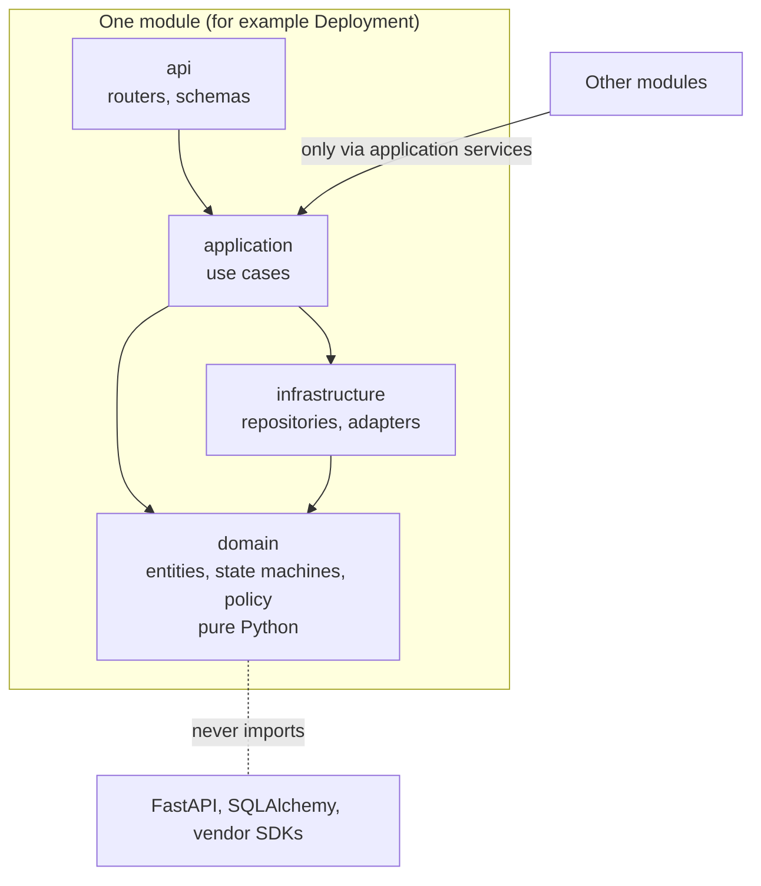

# ADR-001: Modular monolith with ports and adapters

## Status
Proposed

## Context
The platform has four clear domains (registry, governance, deployment, monitoring) and must stay platform agnostic: no hard dependency on a cloud, serving runtime, queue or identity provider. It is built and operated by a small team, and ownership boundaries must still be clear so work can be split across squads later. Operational overhead matters because the control plane must be easy to run, test and replicate.

## Decision
Build a **modular monolith**: one codebase, one container image, two entrypoints (`api` and `worker`). Each domain is a module with layers `api`, `application`, `domain`, `infrastructure`. Infrastructure dependencies sit behind **ports** (`IdentityProvider`, `TaskQueue`, `MetricsStore`, `ArtifactStore`, `ModelRuntime`, `Clock`, `IdGenerator`). Adapters are selected by configuration. Boundaries are enforced in CI with import-linter:

- `domain` imports no framework or vendor SDK.
- Modules call each other only through `application` services.
- A module does not read another module's tables.

Every adapter must pass a shared contract test suite for its port.

## Alternatives Considered
| Alternative | Why not |
|---|---|
| Microservices per domain | Network calls, distributed transactions and many deployables for one small team. The deployment flow needs atomic writes across deployment, audit and outbox. |
| Layered monolith without module boundaries | Cheapest at first, but coupling grows and there is no path to split ownership or services. |
| Framework-coupled design (business logic in route handlers and ORM models) | Hard to unit-test, hard to swap runtime, queue or identity provider. |
| Hexagonal per class everywhere | More ceremony than value for simple CRUD parts. Ports are used only where a real second implementation is plausible. |

## Consequences
### Positive
- One deployable, simple local run (`docker compose up`), atomic transactions across modules where needed.
- Clear ownership seams; a module can later become a service because it already talks through application interfaces.
- Domain logic is testable without a database or network.
- Swapping infrastructure is a configuration change plus one adapter.

### Negative
- Discipline is required; the boundary rules only work if CI enforces them.
- All modules scale together (API replicas carry every module). Acceptable at the expected load.
- Ports add indirection and a contract test suite to maintain.

## Follow-up Actions
- Add import-linter contracts in the first backend commit.
- Write the port contract test suite before the second adapter is added.
- Revisit the monolith decision if a module needs independent scaling or a separate team release cadence.
