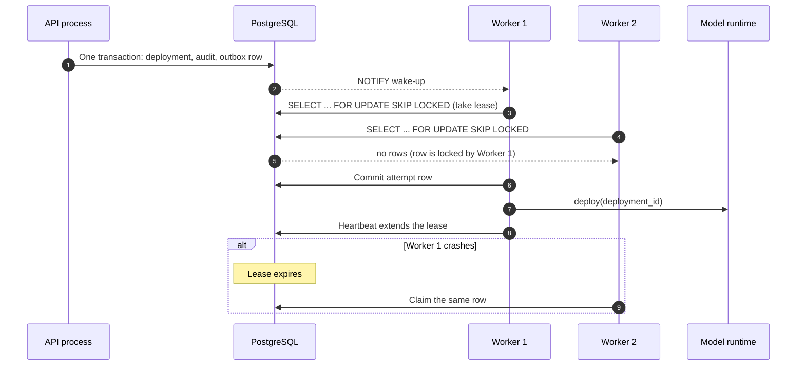

# ADR-002: Asynchronous deployment with a transactional outbox

## Status
Proposed

## Context
Deployment is long-running, calls an external runtime and can fail or time out. The API must answer quickly (`202 Accepted`), survive worker crashes, and never leave the database and the runtime disagreeing silently. A classic dual write (save to the database, then publish to a broker) can lose or duplicate work if the process dies between the two steps. Expected volume is low (about one deployment per minute at 10,000 models), so throughput is not the constraint; correctness is.

## Decision
Use a **transactional outbox in PostgreSQL** as the default `TaskQueue`:

1. The API writes `Deployment`, `AuditEvent`, `IdempotencyRecord` and `OutboxEvent` in **one transaction** and returns `202`.
2. Workers claim outbox rows with `FOR UPDATE SKIP LOCKED`, take a lease and heartbeat. An expired lease lets another worker take over.
3. `LISTEN/NOTIFY` wakes workers quickly; polling is the fallback.
4. The worker commits the **attempt row before** calling the runtime, passes `deployment_id` as the runtime's idempotency key, then commits the result in one transaction.
5. A **reconciler** finds attempts stuck in `DEPLOYING` beyond a timeout, asks `ModelRuntime.status(deployment_id)` and converges the database.
6. Delivery is at-least-once; all handlers are idempotent. Transient failures retry with exponential backoff and jitter.
7. The queue is a port. A broker adapter (Redis, RabbitMQ, SQS, Kafka) can replace the polling consumer later while the outbox relay keeps atomicity.

## Alternatives Considered
| Alternative | Why not |
|---|---|
| Celery or arq on Redis from day one | Adds a stateful component and the dual-write problem unless an outbox is added anyway. |
| Direct broker publish after commit | Message can be lost if the process dies after commit. |
| Synchronous deployment inside the request | Ties up request threads, times out, no retry story. |
| Kafka | Operationally heavy for the volume; no need for replay or fan-out yet. |
| Workflow engine (Temporal, Argo Workflows) | Strong fit at larger scale, but adds a platform to run and learn. Listed as a future option. |

## Consequences
### Positive
- State change and "work to do" are atomic; no lost or phantom jobs.
- No extra infrastructure to run, test or replicate.
- Crash recovery is explicit and testable (reconciler).
- Swapping to a broker is contained behind the `TaskQueue` port.

### Negative
- Throughput ceiling lower than a broker, and the outbox table needs pruning and monitoring (`outbox_lag_seconds`).
- More load on the primary database.
- Polling latency without `LISTEN/NOTIFY` (mitigated by notify).

## Follow-up Actions
- Define outbox event schema versioning (payload `schema_version`).
- Add `outbox_lag_seconds` and `queue_depth` metrics and an alert.
- Write resilience tests: crash after runtime success, crash before attempt commit, duplicate claim.
- Document the broker migration path when sustained load exceeds the agreed threshold.
