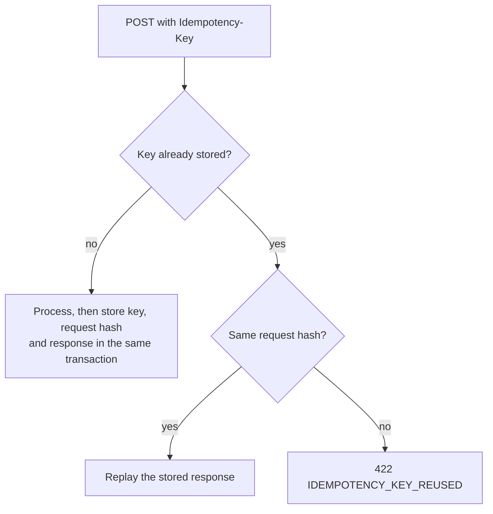
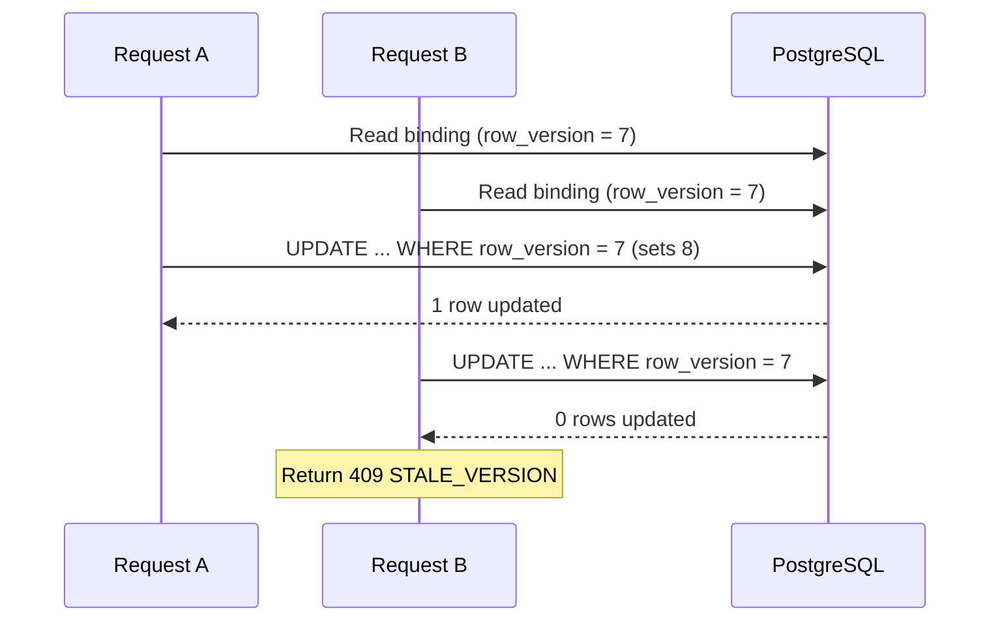
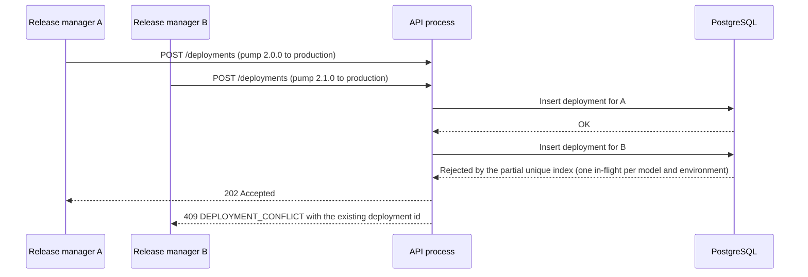

# ADR-003: Idempotency and concurrency control through SQL constraints and compare-and-swap

## Status
Proposed

## Context
Clients retry, users double-click, and several people can promote or roll back the same model at once. The platform must never create duplicate deployments, never run two competing deployments for the same model and environment, and never let a stale read overwrite newer state. These guarantees must hold across multiple API and worker replicas.

## Decision
Enforce correctness in the **database**, not in application memory:

- **Idempotency:** a unique `(tenant, actor, idempotency_key)` record stores a request hash and the response. Same key and same hash replays the response. Same key and different hash returns `422 IDEMPOTENCY_KEY_REUSED`. Records expire after 24 hours.
- **One in-flight deployment:** a partial unique index on `(tenant, model, environment)` where status is `REQUESTED`, `VALIDATING` or `DEPLOYING`. A second request returns `409 DEPLOYMENT_CONFLICT` with the existing `deployment_id`.
- **Optimistic locking:** a `row_version` column on `ModelVersion`, `Deployment` and `EnvironmentBinding`. Updates use compare-and-swap; a lost race returns `409 STALE_VERSION`.
- **Rollback safety:** the rollback target and the binding swap are validated and applied in one transaction with compare-and-swap on the binding.
- **Audit:** the `AuditEvent` is written in the same transaction as the change.
- **External calls:** the runtime receives `deployment_id` as its own idempotency key.

Idempotency decision:

Compare-and-swap on a stale read:

One in-flight deployment per model and environment:

## Alternatives Considered
| Alternative | Why not |
|---|---|
| Distributed lock (Redis, ZooKeeper) | New failure mode and infrastructure; locks can expire mid-operation. |
| Pessimistic row locks held across the whole deployment | Long locks, poor concurrency, deadlock risk. |
| Application-level checks only | Race conditions between replicas. |
| Event sourcing | Powerful but heavy; audit table plus current-state rows is enough here. |

## Consequences
### Positive
- Correct under any number of replicas; no extra systems.
- Behaviour is deterministic and easy to test with parallel requests against real PostgreSQL.
- Clear client contract: `409` means "someone else got there first", and the body says who.

### Negative
- Partial unique indexes and `SKIP LOCKED` are portable across mainstream databases only with care; SQLite cannot validate concurrency, so these tests run on PostgreSQL.
- Clients must handle `409` and `422` explicitly.
- Idempotency records need expiry cleanup.

## Follow-up Actions
- Concurrency tests with real threads and a real database (parallel promotions, duplicate keys, double rollback).
- Scheduled job to purge expired idempotency records.
- Document the retry guidance for clients in `api-design.md`.
