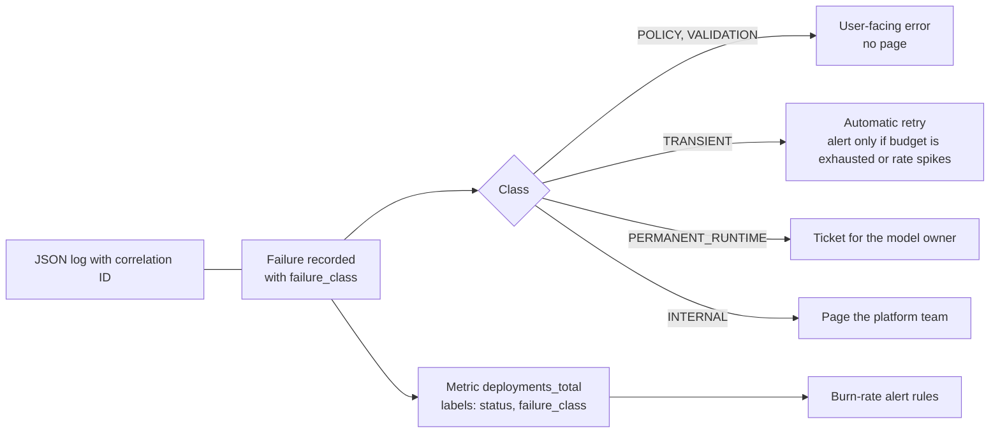

# ADR-004: Standards-first observability and failure classification

## Status
Proposed

## Context
Operators need to answer "what failed, for whom, why, and is it getting worse" quickly. The platform must run in unknown environments, so telemetry cannot depend on one vendor. Not every failure deserves a page: a rejected deployment because a version was not approved is expected behaviour; a database error is an incident.

## Decision
- **Logs:** structured JSON (structlog) with `correlation_id`, `tenant`, `model_id`, `deployment_id`. A middleware accepts or generates `X-Correlation-ID` and stores it in context.
- **Metrics:** Prometheus exposition format on `/metrics` (not exposed through the public gateway). Core series: `deployments_total{status,failure_class}`, `deployment_duration_seconds`, `outbox_lag_seconds`, `queue_depth`, `reconciler_repairs_total`, and HTTP rate, error and duration.
- **Traces:** OpenTelemetry (OTLP) with FastAPI and SQLAlchemy instrumentation. Trace context is stored in the outbox payload so worker spans join the originating request. Collector fan-out is configuration, not code.
- **Health:** `/health/live` and `/health/ready` (database, migration head, worker heartbeat).
- **Failure classification:** `POLICY`, `VALIDATION`, `TRANSIENT`, `PERMANENT_RUNTIME`, `INTERNAL`. The class is stored on the deployment, exposed in the API, used for retry decisions and for alert routing.
- **SLOs and alerting:** burn-rate alerts on availability and deployment start latency; alert rules and dashboards stored in Git (`ops/`).

## Alternatives Considered
| Alternative | Why not |
|---|---|
| A single vendor APM SDK | Lock-in; conflicts with platform-agnostic goal. |
| Logs only | No aggregation, no alerting on rates. |
| Unstructured logs | Cannot be filtered by correlation ID or deployment. |
| Treat every failure the same | Alert fatigue; retry policy cannot differ by cause. |

## Consequences
### Positive
- Works with any OTLP and Prometheus-compatible backend.
- One correlation ID links UI error, API log, outbox event and worker log.
- Retry and paging decisions are data-driven.

### Negative
- OpenTelemetry adds dependencies and some overhead; tracing is optional and can be disabled by configuration.
- Label cardinality must be controlled (no per-model labels on high-volume series).
- Dashboards and rules are extra artifacts to maintain.

## Follow-up Actions
- Define metric names and labels in one module and test that `/metrics` exposes them.
- Ship the Grafana dashboard JSON and Prometheus rules in `ops/`.
- Add a log-schema test to ensure required fields are present.
