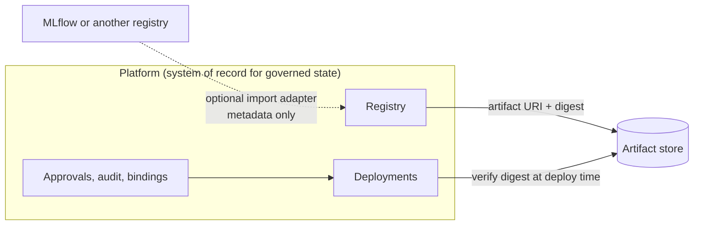

# ADR-005: Own the registry and governance model; integrate MLflow through an adapter

## Status
Proposed

## Context
The platform needs approval, lifecycle promotion, audit history, environment bindings and rollback safety. Existing registries such as MLflow provide model and version tracking, but their stage and approval semantics are generic and their audit trail is limited. Many teams already use MLflow for experiment tracking, so integration value is real, but the system of record for **governed state** must be consistent with deployments and audit in one transaction.

## Decision
The platform owns the registry and governance model (`Model`, `ModelVersion`, `Approval`, `AuditEvent`, `EnvironmentBinding`) in PostgreSQL. Artifacts are referenced by URI and **digest**; the digest is verified at deploy time. External registries are integrated through an optional `ModelRegistryBackend` adapter that can import metadata from, or mirror state to, MLflow or another registry. The adapter is out of scope for the first delivery and documented as an extension.

## Alternatives Considered
| Alternative | Why not |
|---|---|
| MLflow as the source of truth | Cannot join approval, deployment and audit in one transaction; lifecycle semantics differ; adds a mandatory dependency. |
| Dual source of truth with synchronization | Drift and reconciliation problems for governed state. |
| Store only references and let the registry own approval | Approval policy and separation of duties would live outside the platform. |

## Consequences
### Positive
- Atomic guarantees across approval, deployment, binding and audit.
- Platform agnostic: no registry product is required to run.
- Lifecycle and policy rules are unit-testable domain code.

### Negative
- Teams with an existing registry need an import path (the adapter) rather than zero effort.
- The platform owns schema evolution for registry data.

## Follow-up Actions
- Define the `ModelRegistryBackend` port and an import-only MLflow adapter in the roadmap.
- Record `artifact_digest` at registration and verify it in the deploy pipeline.
