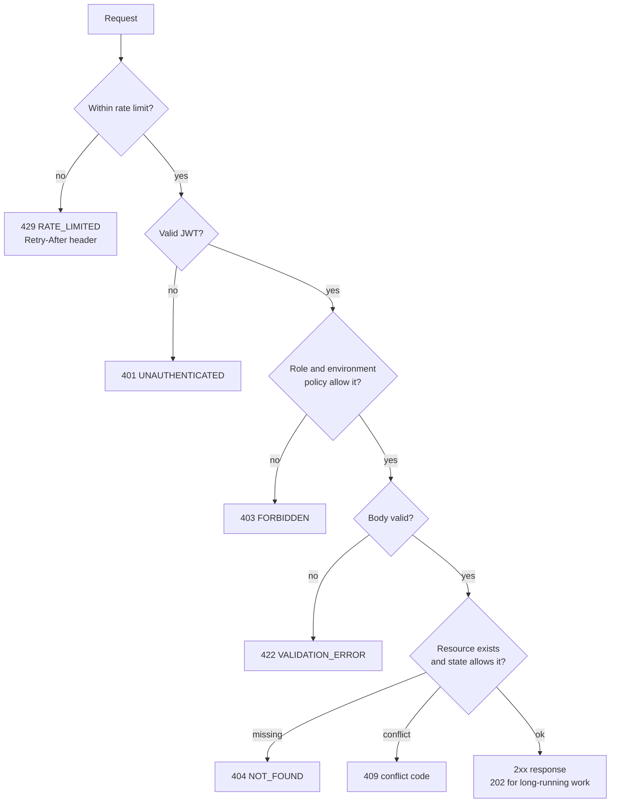
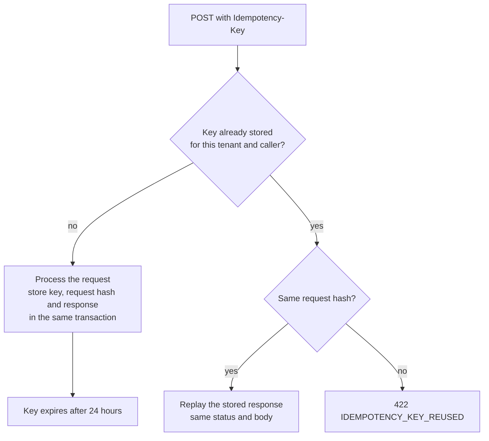
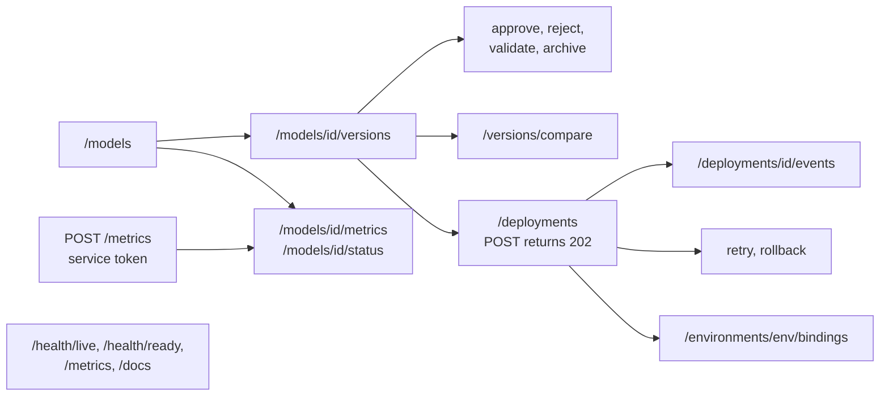
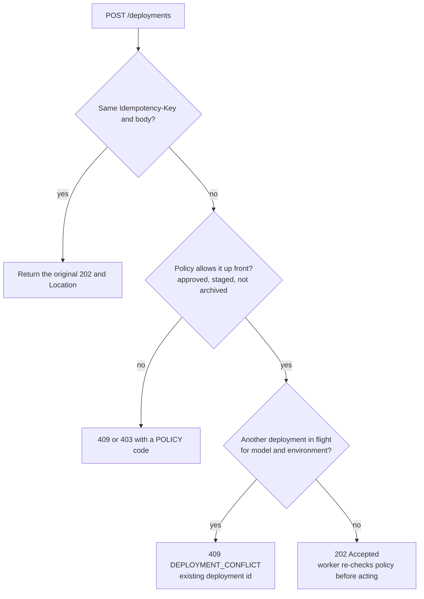
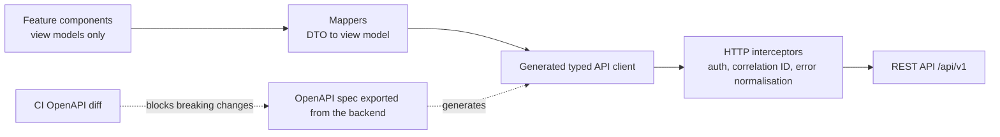

# API Design

Base path: `/api/v1`. JSON over HTTPS. The OpenAPI document is generated from code, exported to `docs/openapi.yaml` by `scripts/export_openapi.py`, and the Angular client is generated from it. Breaking changes are blocked in CI by an OpenAPI diff.

## Conventions

| Topic | Rule |
|---|---|
| Versioning | Path prefix `/api/v1`. Within a version, only additive changes. |
| Authentication | `Authorization: Bearer <JWT>`. Claims map to roles and tenant. |
| Correlation | `X-Correlation-ID` accepted and always returned. Generated if absent. Logged and propagated to traces and outbox payloads. |
| Idempotency | `Idempotency-Key` header required on `POST /deployments` and accepted on other creating or action POSTs. Scoped to (tenant, caller). Same key and same body replays the stored response; same key with a different body returns `422`. Keys expire after 24 hours. |
| Concurrency | Mutable resources return `ETag`; updates may send `If-Match`. Conflicts return `409`. |
| Pagination | Keyset: `?limit=50&cursor=<opaque>`. Response has `items` and `next_cursor`. |
| Filtering | Query parameters, for example `?q=pump&framework=pytorch&stage=PRODUCTION&environment=production&status=FAILED`. |
| Time | RFC 3339 UTC timestamps. |
| Rate limiting | `429` with `Retry-After`. |

### Request decision flow



### Idempotency decision flow



## Error envelope (RFC 7807 style)

Every error uses the same shape and `Content-Type: application/problem+json`.

```json
{
  "type": "https://errors.mlops.example/deployment-conflict",
  "title": "Deployment conflict",
  "status": 409,
  "code": "DEPLOYMENT_CONFLICT",
  "detail": "A deployment for this model and environment is already in progress.",
  "details": { "deployment_id": "dep-1004" },
  "correlation_id": "c1f0a2d4-..."
}
```

| Status | Use | Example codes |
|---|---|---|
| 400 | Malformed request | `BAD_REQUEST` |
| 401 | Missing or invalid token | `UNAUTHENTICATED` |
| 403 | Role or environment policy forbids it | `FORBIDDEN`, `SEPARATION_OF_DUTIES` |
| 404 | Resource does not exist (or not visible to the tenant) | `NOT_FOUND` |
| 409 | State conflict | `DEPLOYMENT_CONFLICT`, `INVALID_TRANSITION`, `STALE_VERSION`, `UNSAFE_ROLLBACK` |
| 422 | Validation failure or idempotency key reuse with a different body | `VALIDATION_ERROR`, `IDEMPOTENCY_KEY_REUSED` |
| 429 | Rate limited | `RATE_LIMITED` |
| 500, 503 | Server error, not ready | `INTERNAL`, `NOT_READY` |

Validation errors list each field in `details.errors[]`. Unknown internal errors never leak stack traces; they return `INTERNAL` with the correlation ID.

### Resource map



## Resources and endpoints

### Registry

| Method | Path | Notes | Role |
|---|---|---|---|
| POST | `/models` | Create model. `201` | ml-engineer |
| GET | `/models` | List, search, filter, paginate | viewer |
| GET | `/models/{model_id}` | Detail with latest versions summary | viewer |
| POST | `/models/{model_id}/versions` | Register version (`version`, `algorithm`, `artifact_uri`, `artifact_digest`, `training_data_ref`, `metadata`, `tags`, `runtime_type`). `201` | ml-engineer |
| GET | `/models/{model_id}/versions` | List versions | viewer |
| GET | `/models/{model_id}/versions/{version}` | Version detail with stage, approval and audit summary | viewer |
| GET | `/models/{model_id}/versions/compare?a=&b=&environment=` | Metadata and metric comparison | viewer |

### Governance

| Method | Path | Notes | Role |
|---|---|---|---|
| POST | `/models/{model_id}/versions/{version}/validate` | DRAFT to VALIDATED after checks | ml-engineer |
| POST | `/models/{model_id}/versions/{version}/approve` | Body: `comment`. Approver must differ from registrant | approver |
| POST | `/models/{model_id}/versions/{version}/reject` | Body: `reason` | approver |
| POST | `/models/{model_id}/versions/{version}/archive` | Allowed per lifecycle rules | release-manager |
| GET | `/audit-events` | Filter by entity, actor, time | admin, approver |

### Deployments

| Method | Path | Notes | Role |
|---|---|---|---|
| POST | `/deployments` | Body: `model_id`, `version`, `environment`. **`202 Accepted`**, `Location: /api/v1/deployments/{id}` | ml-engineer (non-prod), release-manager (production) |
| GET | `/deployments` | Filter by model, version, environment, status | viewer |
| GET | `/deployments/{deployment_id}` | Status, current attempt, failure class | viewer |
| GET | `/deployments/{deployment_id}/events` | Ordered timeline of events and attempts | viewer |
| POST | `/deployments/{deployment_id}/retry` | Only from `FAILED`; creates a new attempt. `202` | ml-engineer / release-manager |
| POST | `/deployments/{deployment_id}/rollback` | Creates a ROLLBACK deployment. `202` | release-manager |
| GET | `/environments/{environment}/bindings` | What is live per model | viewer |

Example request and response:

```http
POST /api/v1/deployments
Authorization: Bearer ...
Idempotency-Key: 6f1b3d9e-5a8c-4b60-9f3e-2f1d0a7c1b11
X-Correlation-ID: c1f0a2d4-7b1e-4c3a-9d55-0a1b2c3d4e5f
Content-Type: application/json

{ "model_id": "pump-failure-predictor", "version": "2.0.0", "environment": "production" }
```

```http
HTTP/1.1 202 Accepted
Location: /api/v1/deployments/dep-1004
X-Correlation-ID: c1f0a2d4-7b1e-4c3a-9d55-0a1b2c3d4e5f

{ "deployment_id": "dep-1004", "status": "REQUESTED", "model_id": "pump-failure-predictor",
  "version": "2.0.0", "environment": "production", "attempt": 0 }
```

### Monitoring

| Method | Path | Notes | Role |
|---|---|---|---|
| POST | `/metrics` | Batch ingest (max batch size configurable). Service token. `202` | service |
| GET | `/models/{model_id}/metrics` | Params: `version`, `environment`, `from`, `to`, `resolution` (`raw`, `hour`, `day`). Returns series plus summary | viewer |
| GET | `/models/{model_id}/status` | `HEALTHY`, `DEGRADED`, `CRITICAL`, `STALE`, `NO_DATA`, with reasons and last successful inference | viewer |

### Operational endpoints (unversioned)

| Path | Purpose |
|---|---|
| `/health/live` | Process is up |
| `/health/ready` | Database reachable, migrations at expected head, worker heartbeat recent |
| `/metrics` | Prometheus format (not exposed through the public gateway) |
| `/docs`, `/openapi.json` | Interactive docs and the contract |

## Behaviours worth stating

- **Duplicate deployment request:** same `Idempotency-Key` and body returns the original `202` and `Location`. A different key for the same model, version and environment while one is in flight returns `409 DEPLOYMENT_CONFLICT` with the existing `deployment_id`.
- **Unapproved version to production:** the request is accepted only if policy allows. A policy failure is returned synchronously as `409` or `403` with a `POLICY` code when it can be checked up front; the worker repeats the check and records `POLICY` if state changed in the meantime.
- **Retry:** returns `409 INVALID_TRANSITION` unless the deployment is `FAILED`.
- **Rollback:** returns `409 UNSAFE_ROLLBACK` with the failed precondition in `details`.

Deploy request decision flow:



## UI isolation

The Angular app uses only a generated client. DTOs are mapped to view models in one place. Error responses are normalized by a single interceptor into a UI error type that carries `code`, `title`, `detail` and `correlation_id`, so every error state can show a reference an operator can search in the logs.


