# Architecture Document

Role level: **G12 (Principal Software Engineer / Technical Lead)**

Status: Proposed (design baseline, implementation follows)

Diagrams: [`diagrams/architecture.drawio`](diagrams/architecture.drawio) (editable, 4 pages), exported PNGs in [`diagrams/`](diagrams/) and [`architecture-diagram.png`](architecture-diagram.png).

| Page | Diagram |
|---|---|
| 1 | Logical architecture ([PNG](diagrams/01-logical-architecture.png)) |
| 2 | Deployment and delivery view ([PNG](diagrams/02-deployment-and-delivery.png)) |
| 3 | Asynchronous deployment workflow ([PNG](diagrams/03-async-deployment-workflow.png)) |
| 4 | State machines and invariants ([PNG](diagrams/04-state-machines.png)) |

Diagram-as-code versions (Mermaid, render on GitHub): [`diagrams/mermaid-diagrams.md`](diagrams/mermaid-diagrams.md) has the system overview, modules and ports, deployment sequence, version lifecycle, deployment states, failure handling, data model and delivery pipeline.

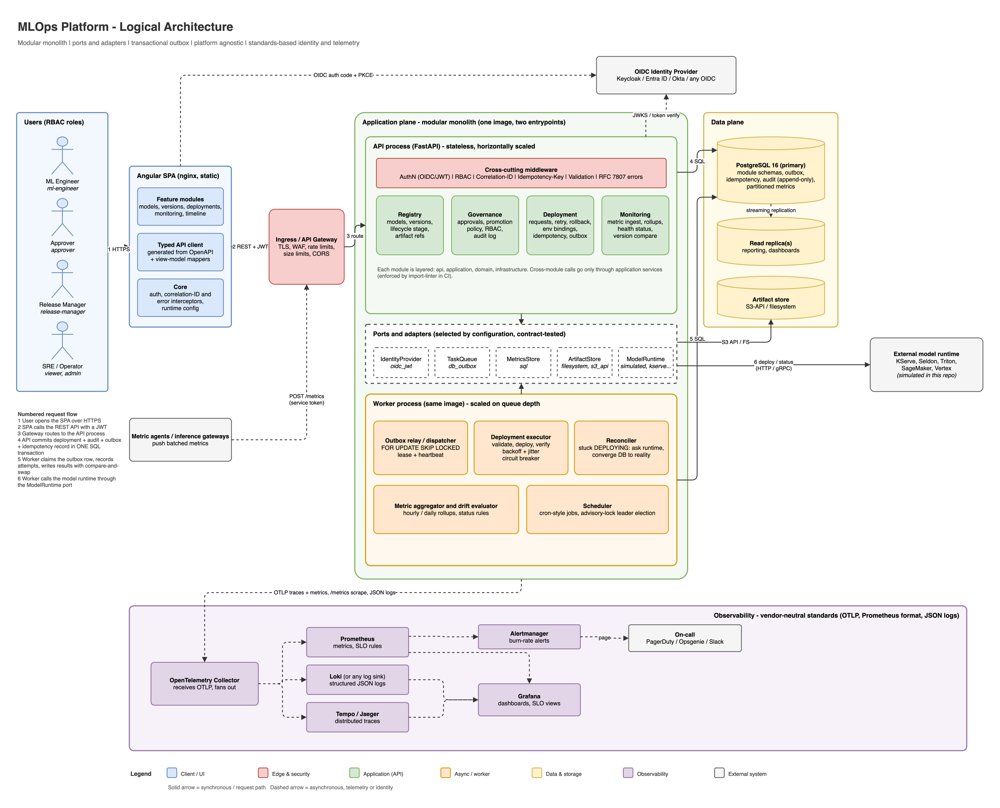

## 1. Context

An industrial organization runs many ML models across plants and environments. Today a model's journey from "trained" to "serving" depends on people, spreadsheets and ad hoc scripts. The platform is the **control plane** that makes that journey governed, observable and reversible:

- register models and versions, with metadata and artifact Vreferences
- approve and promote versions through a controlled lifecycle
- deploy to environments asynchronously, safely and idempotently
- monitor latency, throughput, error rate, quality, drift and availability
- retry failures and roll back safely
- give operators an Angular UI and an auditable history

It is a control plane, not a serving plane. If it is down, models that are already deployed keep serving. Only changes are blocked. This is a deliberate property.

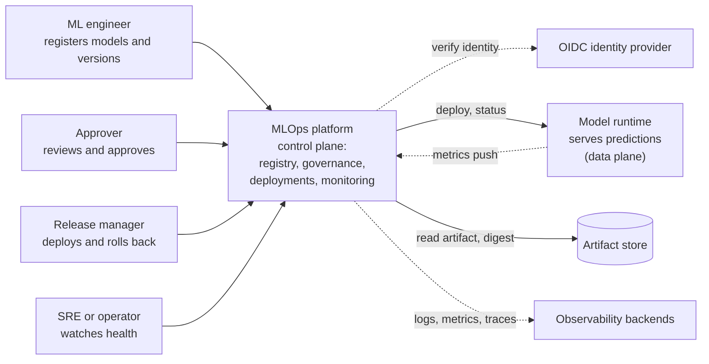

## 2. Scope

**In scope:** registry, approval and promotion governance, async deployment, retry, rollback, monitoring and health evaluation, audit, RBAC, Angular operations UI, packaging, CI and operability.

**Out of scope:** model training, feature stores, a real serving runtime (simulated behind a port), a real identity provider (standards-based integration only), multi-region active-active.

**Non-goals (deliberately not built, to avoid overengineering):**

| Not building | Why |
|---|---|
| Microservices | One team, one deployable. Module seams allow a later split. |
| Kafka or a service mesh | Deployment volume is low (see section 11). A DB outbox is sufficient and atomic with state changes. |
| MLflow as source of truth | Governance and audit must be owned by the platform. MLflow can be mirrored through an adapter. |
| Kubeflow or Airflow | They solve training pipelines, which are out of scope. |
| Server push (SSE/WebSocket) | Polling with backoff is enough for the UI. SSE is a later option behind the same API. |

## 3. Architecture overview

**In one sentence:** a single backend application keeps an auditable record of ML models and hands slow deployment work to a background worker; an Angular website sits in front of it and PostgreSQL sits behind it.

**Style: modular monolith with ports and adapters.** One codebase produces one image with two entrypoints (`api` and `worker`). Domain modules have enforced boundaries. Every infrastructure dependency sits behind a port, and the adapter is chosen by configuration.

### 3.1 Control plane versus data plane

The platform is a **control plane**: it decides, records and coordinates. The model runtime that actually serves predictions is the **data plane**, and it is external. If the platform is down, models that are already deployed keep serving; only changes (new deployments, promotions, rollbacks) are blocked. An analogy is a booking office for operating rooms: the office schedules and keeps the ledger, but surgery continues if the office closes.

### 3.2 The five blocks

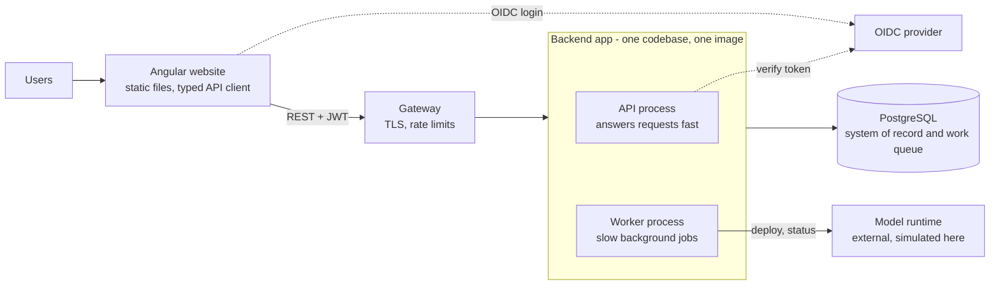

| Block | What it is | What it does | Key rule |
|---|---|---|---|
| Angular website | Static files served by nginx | Shows models, versions, deployments, monitoring, timeline | Talks only to the versioned REST API (`/api/v1`) through a client generated from the OpenAPI spec; never imports backend code |
| Gateway | Ingress or API gateway | TLS, rate limits, request size limits, CORS | First line of defence, before any application code |
| Backend app | One codebase, started in two modes (`api`, `worker`) | `api` answers requests quickly; `worker` runs slow background jobs | Same image for both, so they never drift apart |
| PostgreSQL | Primary database with replica | System of record: registry, deployments, audit log, work queue, metrics | Enforces the important rules with constraints |
| Model runtime | External serving platform (simulated here) | Serves the models | Reached only through the `ModelRuntime` port |

Identity is external too: users log in at any OIDC provider, and the API only validates the token it receives.

### 3.3 Inside the backend app

**Two modes**
- The **API process** is stateless and scales by adding replicas. Every request passes through the same middleware chain: correlation ID, authentication, authorization (role and environment policy), idempotency check, validation, and a single error format. It handles synchronous work and accepts long-running work with `202 Accepted`.
- The **worker process** executes deployments, reconciles stuck work, aggregates metrics and runs scheduled jobs.

**Four modules** (like four departments)

| Module | Plain meaning |
|---|---|
| Registry | The catalogue of models and versions and their stage |
| Governance | Approvals, role rules and the permanent audit log |
| Deployment | Deployment requests, retry, rollback and "what is live now" |
| Monitoring | Incoming performance metrics and model health status |

Each module has four layers (`api`, `application`, `domain`, `infrastructure`). Modules call each other only through their `application` layer and never read each other's tables. CI enforces this, which is what makes "monolith now, split later" realistic.

Request path inside the API process:

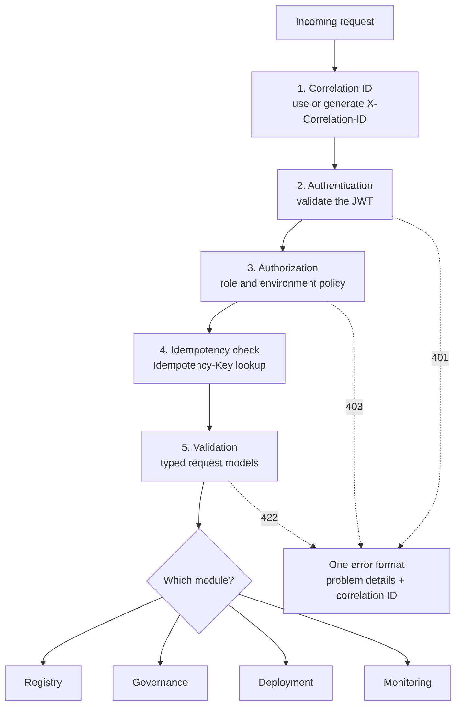

### 3.4 Six design ideas

1. **One program, not many services.** A deployment needs the deployment row, the audit entry and the "work to do" note saved together. Across services that would need distributed transactions. One program with clear internal boundaries is simpler and safer for a small team.
2. **Plug-in connectors (ports and adapters).** Business code asks for "a runtime" or "a queue" through an interface. Configuration chooses the implementation (simulated runtime and database queue today; KServe or a broker later). No `if aws:` branches exist anywhere.
3. **Save the request and the to-do together (transactional outbox).** One database transaction writes the deployment, the audit event and the outbox row that tells the worker to act. Either all are saved or none are, so a deployment can never exist without anyone processing it.
4. **Write down intent before acting.** The worker commits an attempt row before calling the runtime and uses the deployment ID as the runtime's own idempotency key. If the worker crashes mid-way, the reconciler asks the runtime what really happened and repairs the records.
5. **Let the database enforce the rules.** A partial unique index allows only one in-flight deployment per model and environment, and compare-and-swap on a version counter rejects updates based on stale data. This stays correct with many replicas running.
6. **Explicit state machines.** Version lifecycle and deployment status move only along allowed transitions defined in tables, with guards (approval, separation of duties, staging before production). Illegal moves are rejected and are unit-tested without a database.

### 3.5 A deployment, end to end

1. The engineer requests a deployment in the UI.
2. The gateway forwards it; the API checks identity, role and policy (is the version approved?).
3. One transaction saves the deployment (`REQUESTED`), the audit event, the outbox row and the idempotency record. The API replies `202 Accepted` with a ticket (`Location` header).
4. The worker claims the outbox row (`FOR UPDATE SKIP LOCKED`, with a lease), re-validates, and commits the attempt row.
5. The worker calls the runtime, waits until it reports ready, then commits `SUCCEEDED`, updates "what is live" and writes audit in one transaction.
6. The UI, polling the ticket with backoff, shows the result.

Failures are classified (`POLICY`, `VALIDATION`, `TRANSIENT`, `PERMANENT_RUNTIME`, `INTERNAL`). Only transient failures retry automatically, with exponential backoff and jitter; the class also decides who gets paged. Full detail is in section 7 and on diagram page 3.

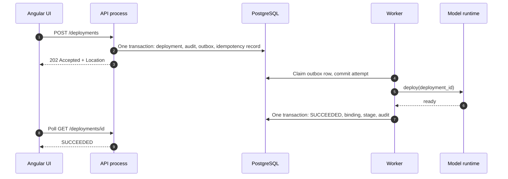

### 3.6 Cross-cutting concerns in one line each

- **Security:** OIDC login, role-based access, separation of duties, tenant scoping, append-only audit, artifact digest verification.
- **Observability:** JSON logs with a correlation ID, Prometheus-format metrics, optional OpenTelemetry traces, live and ready health endpoints.
- **Packaging:** container images, Docker Compose locally, Helm on Kubernetes, the same image promoted through environments.
- **Telemetry** uses open standards (OTLP, Prometheus format, JSON logs), so any backend can consume it.

### 3.7 Synchronous versus asynchronous

| Work | Mode | Reason |
|---|---|---|
| Model and version CRUD, approvals, reads | Synchronous | Short, needs immediate consistency and a clear error |
| Deployment (validate, deploy, verify) | **Asynchronous** | Long-running, calls an external runtime, can fail and retry |
| Reconciliation of stuck work | Asynchronous (scheduled) | Self-healing without operator action |
| Metric rollups and drift evaluation | Asynchronous (scheduled) | Batch compute, off the request path |
| Metric ingest | Synchronous, batched | Cheap append, returns `202` after the commit |

## 4. Technology decisions

| Concern | Choice | Why | Rejected alternatives |
|---|---|---|---|
| Language and API | Python 3.12, FastAPI, Pydantic v2 | Typed contracts, validation and OpenAPI built in; matches the ML ecosystem | Django REST (heavier), Flask (no typing by default) |
| Persistence | PostgreSQL 16, SQLAlchemy 2.0, Alembic | Constraints, partial unique indexes, row locks, `SKIP LOCKED`, partitioning, JSONB | MySQL (weaker partial indexes), NoSQL (no strong constraints) |
| Test DB | SQLite for pure unit tests only | Fast feedback; integration tests run on real Postgres | SQLite everywhere (hides concurrency bugs) |
| Queue | DB transactional outbox, broker optional | Atomic with state change, no extra infrastructure, broker is a port swap | Celery or arq on Redis first (dual-write risk, extra moving part) |
| Worker wake-up | Polling with `LISTEN/NOTIFY` as accelerator | Low latency without a broker | Pure polling at a short interval |
| Connection management | PgBouncer in transaction pooling mode | Many API and worker replicas without exhausting connections | Direct connections |
| Frontend | Angular (current stable), standalone components, Angular Material, RxJS | Matches the brief; typed client, strong testing story | React (not in the brief) |
| API contract | OpenAPI generated from code, typed TS client generated from it | Isolates the UI from backend internals | Hand-written client |
| Identity | OIDC and JWT, any compliant provider, local dev provider | Standards-based, no lock-in | Custom auth |
| Observability | structlog JSON logs, OpenTelemetry (OTLP), Prometheus format `/metrics` | Vendor-neutral | A single vendor SDK |
| Packaging | OCI images, Docker Compose locally, Helm for Kubernetes | Runs anywhere, same images everywhere | Cloud-specific templates |
| CI/CD | GitHub Actions calling `make` targets, GitOps promotion | Thin CI wrapper keeps pipelines portable | Logic embedded in CI YAML |

## 5. Components and ownership

| Module | Responsibility | Owns |
|---|---|---|
| `registry` | Models, versions, metadata, artifact references, lifecycle stage | `model`, `model_version` |
| `governance` | Approvals, promotion policy, RBAC, append-only audit | `approval`, `audit_event` |
| `deployment` | Deployment lifecycle, environment bindings, retry, rollback, outbox, idempotency | `deployment`, `deployment_attempt`, `environment_binding`, `outbox_event`, `idempotency_record` |
| `monitoring` | Metric ingest, rollups, status evaluation, version comparison | `metric_sample`, `metric_rollup`, `monitor_status` |
| `platform` | Configuration, logging, tracing, metrics, error envelope, health | none |

Each module has four layers: `api`, `application`, `domain`, `infrastructure`. Rules, enforced in CI with import-linter:

1. `domain` imports nothing from FastAPI, SQLAlchemy or vendor SDKs.
2. Modules call each other only through `application` services.
3. A module never reads another module's tables.

### Ports and adapters

| Port | Reference adapter | Future adapters |
|---|---|---|
| `IdentityProvider` | `oidc_jwt` (JWKS validation) | any OIDC provider |
| `TaskQueue` | `db_outbox` | Redis, RabbitMQ, SQS, Kafka |
| `MetricsStore` | `sql` (partitioned tables) | Timescale, ClickHouse, Prometheus remote-write |
| `ArtifactStore` | `filesystem`, `s3_api` | GCS, Azure Blob, NFS |
| `ModelRuntime` | `simulated` (failure injection) | KServe, Seldon, Triton, SageMaker, Vertex |
| `Clock`, `IdGenerator` | system | deterministic fakes for tests |

Every port has a shared contract test suite that every adapter must pass. Configuration selects adapters (`RUNTIME_BACKEND`, `QUEUE_BACKEND`, `ARTIFACT_BACKEND`, `METRICS_BACKEND`); business code has no cloud-specific branches.

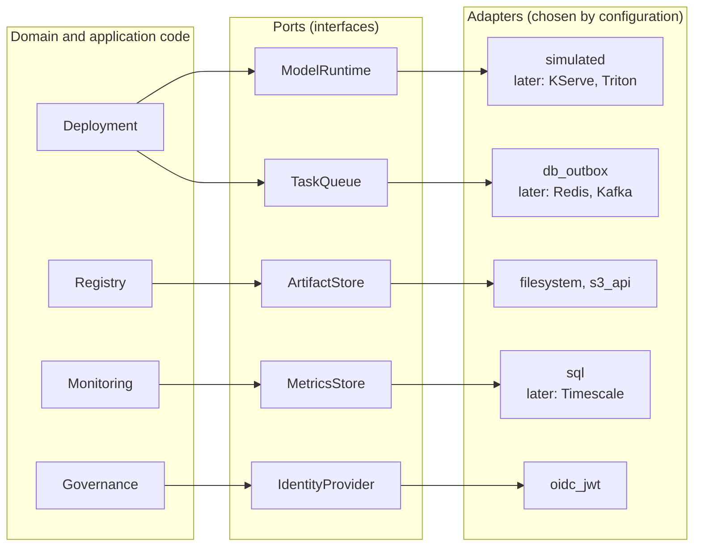

## 6. Domain model

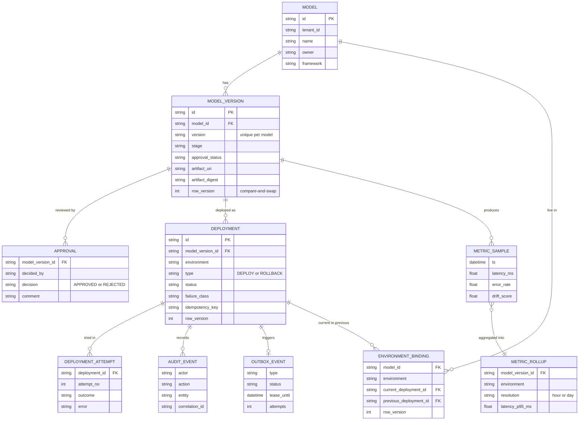

| Entity | Key fields |
|---|---|
| Model | `id`, `tenant_id`, `name`, `owner`, `framework`, `tags`, timestamps |
| ModelVersion | `id`, `model_id`, `version` (unique per model), `algorithm`, `artifact_uri`, `artifact_digest`, `training_data_ref`, `metadata`, `stage`, `approval_status`, `runtime_type`, `row_version` |
| Deployment | `id`, `model_version_id`, `environment`, `type` (DEPLOY or ROLLBACK), `status`, `failure_class`, `requested_by`, `idempotency_key`, `correlation_id`, `row_version` |
| DeploymentAttempt | `deployment_id`, `attempt_no`, `started_at`, `finished_at`, `outcome`, `error`, `runtime_ref` |
| EnvironmentBinding | unique `(tenant, model, environment)`, `current_deployment_id`, `previous_deployment_id`, `row_version` |
| AuditEvent | `actor`, `action`, `entity`, `before`, `after`, `correlation_id`, `ts` |
| OutboxEvent | `type`, `payload` (versioned), `status`, `available_at`, `attempts`, `locked_by`, `lease_until` |
| IdempotencyRecord | unique `(tenant, actor, key)`, `request_hash`, `response_status`, `response_body`, `expires_at` |

### Lifecycle state machine

`DRAFT -> VALIDATED -> APPROVED -> STAGING -> PRODUCTION -> ARCHIVED` (see diagram page 4).

| Transition | Guard |
|---|---|
| DRAFT to VALIDATED | validation checks pass (artifact reachable, metadata complete) |
| VALIDATED to APPROVED | role `approver`; approver must differ from the registrant |
| APPROVED to STAGING | caused by a successful staging deployment |
| STAGING to PRODUCTION | caused by a successful production deployment; policy requires approval and a prior successful staging deployment |
| any stage to ARCHIVED | allowed only when the version is not live in any environment. Superseding a version does not archive it, so it stays available as a rollback target until someone archives it |
| rejected approval | the version stays VALIDATED, audit event recorded, resubmission allowed |

Stage never changes by editing a field. It changes as a side effect of governance actions or deployment outcomes.

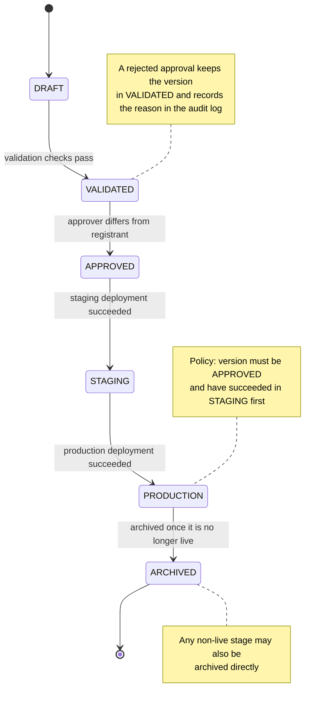

### Deployment state machine

`REQUESTED -> VALIDATING -> DEPLOYING -> SUCCEEDED -> ROLLED_BACK`, with `FAILED` reachable from `VALIDATING` and `DEPLOYING`, and retry from `FAILED` back to `REQUESTED` as a new attempt.

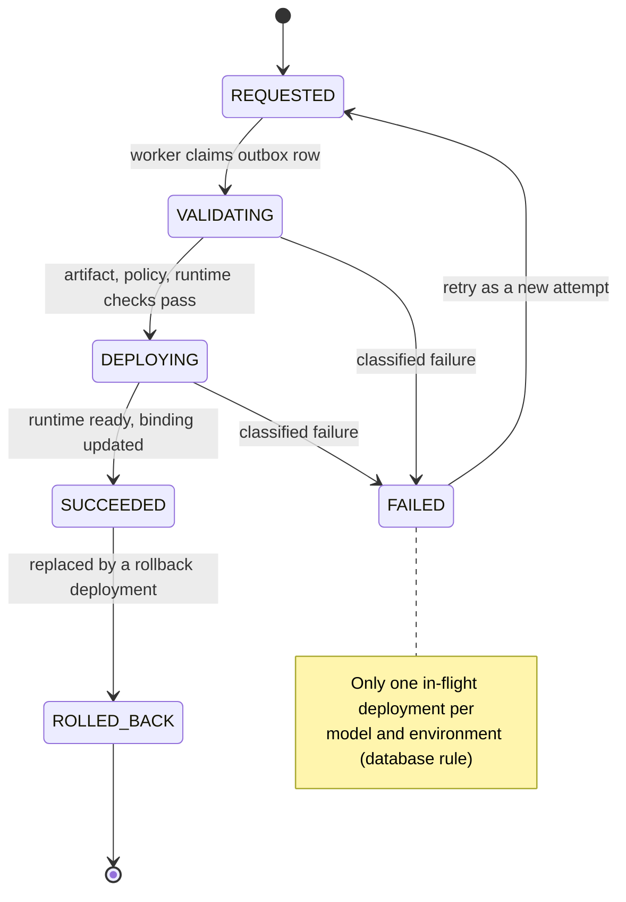

### Failure classification

| Class | Examples | Retry |
|---|---|---|
| `POLICY` | not approved, no staging deployment | No, until the cause changes |
| `VALIDATION` | artifact missing, runtime incompatible | No, until fixed |
| `TRANSIENT` | runtime timeout, 5xx, network | Automatic with backoff, then manual |
| `PERMANENT_RUNTIME` | runtime rejects the model | Manual only |
| `INTERNAL` | platform bug, database error | After investigation |

Seed mapping: `approval_validation_failed` is `POLICY`; `runtime_timeout` is `TRANSIENT`.

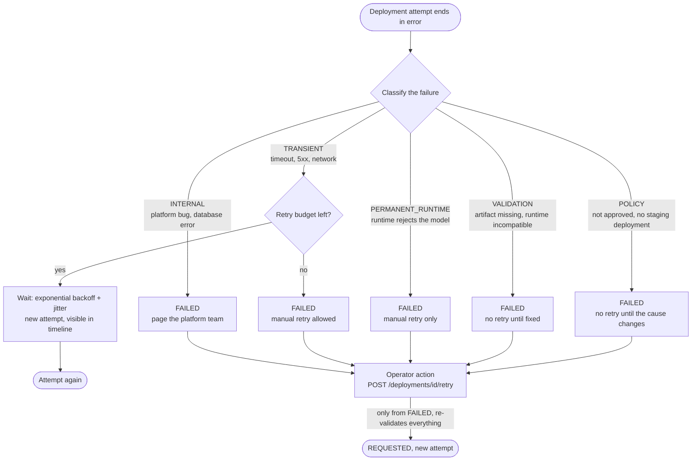

## 7. Key workflows

The asynchronous deployment flow is on diagram page 3.

### 7.1 Deploy (asynchronous, idempotent)

1. `POST /deployments` with `Idempotency-Key`. API authorizes the caller, looks up the key, checks policy.
2. One database transaction writes the `Deployment` (`REQUESTED`), the `AuditEvent`, the `OutboxEvent` and the `IdempotencyRecord`. A partial unique index rejects a second in-flight deployment for the same model and environment with `409`.
3. API returns `202 Accepted` with a `Location` header.
4. The worker claims the outbox row (`FOR UPDATE SKIP LOCKED`, lease with heartbeat).
5. The attempt row is committed **before** the external call (`VALIDATING`, then `DEPLOYING`).
6. The worker calls `ModelRuntime.deploy` with the `deployment_id` as the external idempotency key, then verifies readiness.
7. One transaction records `SUCCEEDED`, swaps the environment binding with compare-and-swap, updates the stage, writes audit and emits the outbox event.
8. The UI polls `GET /deployments/{id}` with backoff until a terminal state.

On error the worker classifies the failure, records `FAILED`, and schedules a backoff retry for `TRANSIENT` failures.

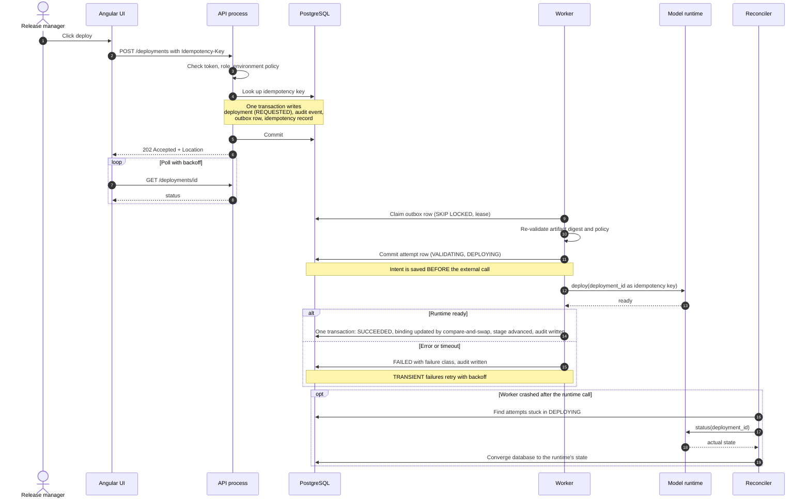

### 7.2 External success versus internal database failure

1. Intent is durable before the side effect (attempt row, step 5).
2. The runtime call is idempotent on `deployment_id`, so repeating it is harmless.
3. If the worker crashes after the runtime succeeded but before step 7, the reconciler finds attempts stuck in `DEPLOYING` beyond a timeout, asks `ModelRuntime.status(deployment_id)`, and converges the database to reality.
4. State change and outbox event share one transaction, so there are no dual writes.

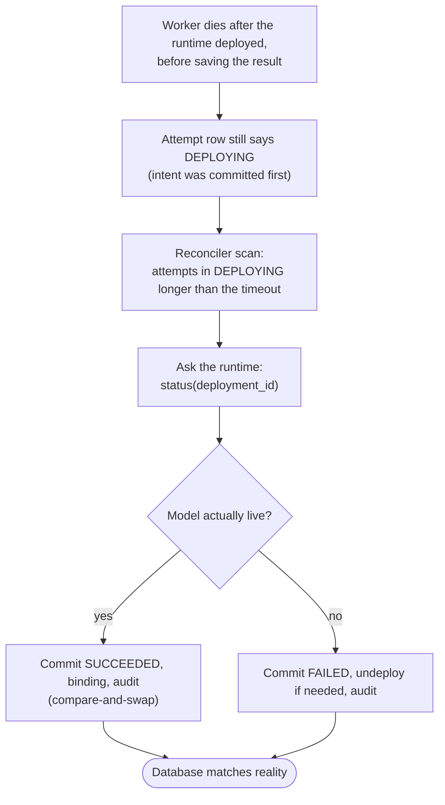

### 7.3 Rollback

Checked in one transaction: a binding with a previous deployment exists; the target version is approved, not archived or rejected; its artifact digest still verifies; the runtime reports it compatible; no in-flight deployment exists for the model and environment; the caller has role `release-manager` for production. Then a `ROLLBACK` deployment runs through the same async pipeline. A concurrent second rollback fails the compare-and-swap with `409`.

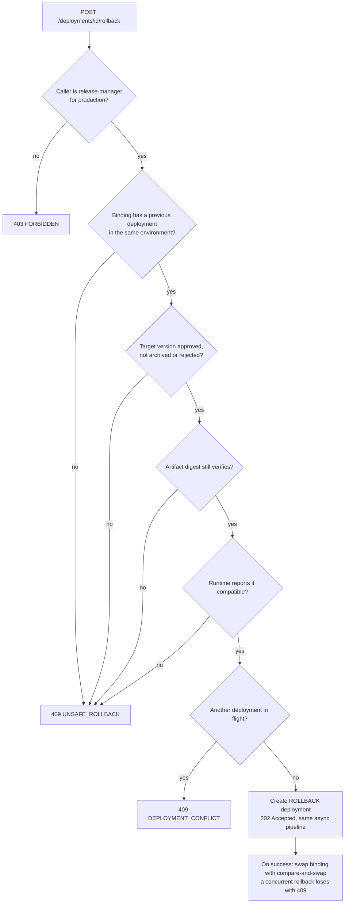

### 7.4 Conflicting promotions

Two layers: the partial unique index on in-flight deployments, and compare-and-swap on `row_version` for bindings and versions. Two concurrent promotions cannot both succeed; the loser receives a deterministic `409`.

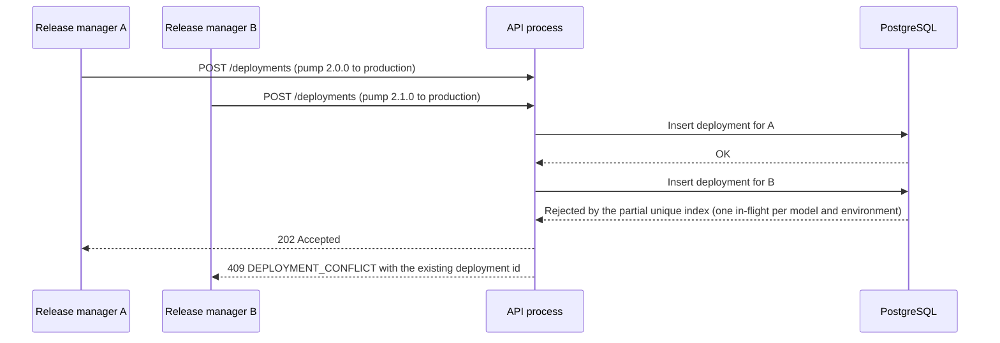

## 8. Reliability

| Concern | Design |
|---|---|
| Delivery semantics | At-least-once, with idempotent handlers |
| Worker crash | Lease expiry lets another worker claim the row |
| Stuck work | Reconciler converges database and runtime |
| External dependencies | Timeouts, bounded retries with exponential backoff and jitter, circuit breaker around `ModelRuntime`, bulkheads per environment |
| Overload | Rate limits at the gateway, request size limits, bounded queues, `429` with `Retry-After` |
| Scheduler | Advisory-lock leader election so scheduled jobs run once |
| API availability | At least 2 replicas across zones, PodDisruptionBudget, rolling updates with `maxUnavailable: 0`, graceful shutdown |
| Database | HA primary with replica and automatic failover; PgBouncer; statement and lock timeouts |
| Backup | WAL archiving and base backups, point-in-time recovery, scheduled restore drill. Proposed RPO 5 minutes or less, RTO 1 hour or less |
| Control plane versus data plane | Platform outage blocks changes only; deployed models keep serving |
| Testability | The simulated runtime injects timeouts, errors and latency so resilience paths are tested |

## 9. Security

| Area | Design |
|---|---|
| Authentication | OIDC and JWT; JWKS cached; issuer, audience and clock skew validated |
| Authorization | RBAC roles `viewer`, `ml-engineer`, `approver`, `release-manager`, `admin`; per-environment policy table (required approval, required prior environment, allowed roles, optional change window) |
| Separation of duties | Approver must differ from the registrant |
| Tenant isolation | `tenant_id` on every table and unique key, taken from the token; enforced in the repository layer; Postgres row-level security as defense in depth |
| Audit | Append-only, same transaction as the change; the application role has insert-only privilege |
| Artifact integrity | Digest recorded at registration, verified at deploy time |
| Secrets | Environment variables supplied from the platform secret store; never in Git; `.env.example` only |
| Network | Default-deny NetworkPolicies; only API and worker reach the database; TLS at the gateway and for sensitive in-cluster paths |
| Containers | Non-root, read-only root filesystem, dropped capabilities, seccomp default |
| Supply chain | Locked dependencies, pinned base image digests, SBOM, vulnerability and secret scanning, signed images |
| Input handling | Pydantic validation, parameterized SQL through the ORM, request size limits |

Defence in depth on every request:

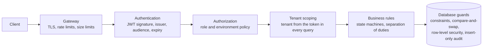

### Threat model (STRIDE summary)

| Threat | Example | Mitigation |
|---|---|---|
| Spoofing | Forged token | OIDC signature, issuer and audience checks |
| Tampering | Edited artifact after approval | Digest verification at deploy time |
| Repudiation | "I never approved that" | Append-only audit with actor and correlation ID |
| Information disclosure | Cross-tenant read | Tenant scoping in repositories plus row-level security |
| Denial of service | Request flood, huge payloads | Gateway rate limits, size limits, bounded queues |
| Elevation of privilege | Deploy to production without approval | Server-side policy checks, RBAC, database constraints |
| Replay | Resent deployment request | Idempotency key with request hash |

## 10. Observability

| Signal | Implementation |
|---|---|
| Logs | structlog JSON with `correlation_id`, `tenant`, `model_id`, `deployment_id` |
| Traces | OpenTelemetry (OTLP). Trace context travels in the outbox payload so worker spans link to the originating request. Optional if time-boxed |
| Metrics | Prometheus format: `deployments_total{status,failure_class}`, `deployment_duration_seconds`, `outbox_lag_seconds`, `queue_depth`, `reconciler_repairs_total`, HTTP request rate, errors and duration |
| Health | `/health/live` (process), `/health/ready` (database reachable, migrations at expected head, worker heartbeat) |
| Failure classification | Feeds alert routing: platform bugs page the platform team; `POLICY` failures do not page |

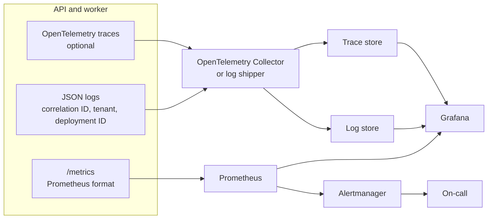

**Dashboard proposal**

1. Platform health: request rate, error rate, latency percentiles, outbox lag.
2. Deployment flow: success rate, failure classes, duration, stuck count.
3. Model fleet: models by monitoring status, drift and quality outliers.
4. Governance: pending approvals, promotions, rollbacks.

**Alerts:** outbox lag over threshold, stuck deployments, failure-rate spike, readiness failures, SLO burn rate (fast and slow windows).

**Proposed SLOs**

| SLI | Target |
|---|---|
| API availability | 99.9% monthly |
| API read latency p95 | under 300 ms |
| `POST /deployments` p95 | under 500 ms |
| Deployments starting within 30 s of request | 95% |
| Audit write durability | 100% (same transaction) |

## 11. Scaling

Working assumptions (stated so they can be challenged): 10,000 models, about 5 versions each, 2 active environments per model, 1 metric sample per minute per model and environment, about 1 deployment per model per week.

| Dimension | Estimate | Consequence |
|---|---|---|
| Deployments | about 10,000 per week, roughly 1 per minute on average | A DB outbox with `SKIP LOCKED` handles this with large headroom |
| Metric samples | about 29 million rows per day (about 3 GB per day at roughly 100 bytes per row) | Time partitioning, rollups, short raw retention |
| Registry rows | about 50,000 versions | Trivial for PostgreSQL |

| Concern | 100 models | 10,000 models |
|---|---|---|
| API | 1 to 2 replicas | Stateless horizontal scaling (HPA) |
| Workers | 1 to 2 | Scale on queue depth (KEDA or HPA), per-environment concurrency caps |
| Queue | DB outbox | Broker adapter; outbox relay kept for atomicity |
| Reads | direct | Read replicas, keyset pagination, ETag caching, optional Redis cache |
| Metrics | one SQL table | Monthly partitions, hourly and daily rollups, raw retention of days, then a time-series store behind `MetricsStore` |
| Tenancy | single | Tenant-scoped partitions or shards, per-tenant quotas, fair queue scheduling |
| Database connections | direct | PgBouncer transaction pooling |

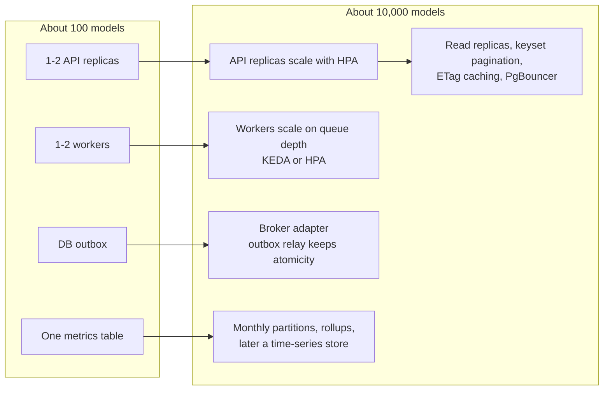

## 12. Deployment view

See diagram page 2.

- `api` and `frontend` Deployments, `worker` Deployment scaled on queue depth, a `migrate` Job as a pre-upgrade hook.
- Ingress with TLS (cert-manager), secrets from a secret store (ExternalSecret), ConfigMap for non-secret settings, NetworkPolicies.
- PostgreSQL as managed service or operator (for example CloudNativePG), with PgBouncer, replica and backups.
- Observability namespace: OpenTelemetry Collector, Prometheus with Alertmanager, Loki, Tempo or Jaeger, Grafana. Any backend can replace these.
- Delivery: GitHub Actions builds, scans, signs and pushes images by digest; a GitOps repo holds per-environment Helm values; Argo CD or Flux reconciles. Promotion is a pull request that changes the image digest.
- Local equivalent: Docker Compose with `api`, `worker`, `frontend`, `db`, using the same environment variable contract.

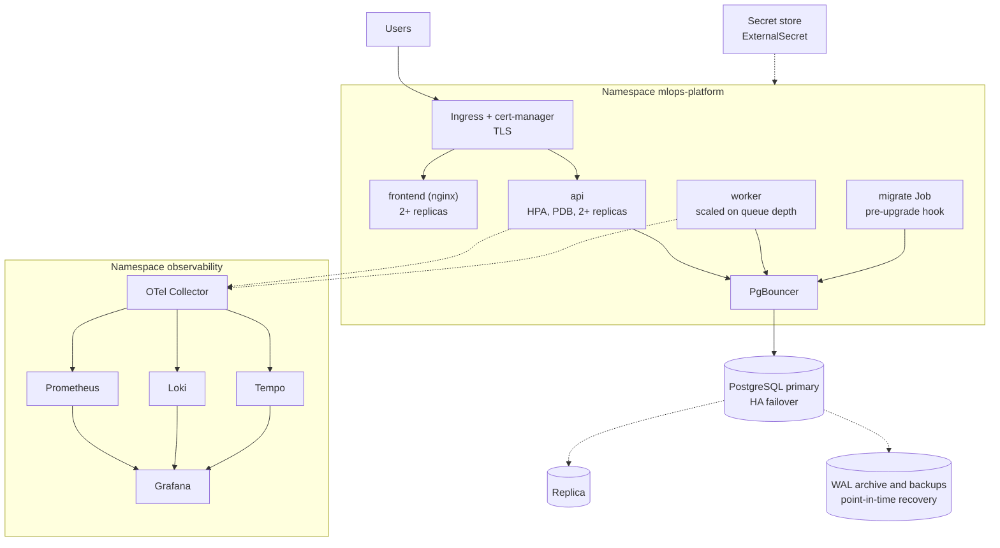

Cloud mapping (illustrative; nothing in the base chart is cloud specific):

| Need | AWS | Azure | GCP | On-prem |
|---|---|---|---|---|
| Kubernetes | EKS | AKS | GKE | any conformant distribution |
| PostgreSQL | RDS | Flexible Server | Cloud SQL | operator |
| Object store | S3 | Blob | GCS | MinIO |
| Identity | Cognito or any OIDC | Entra ID | any OIDC | Keycloak |

## 13. CI/CD and release

| Stage | Checks |
|---|---|
| Pre-commit | ruff, mypy, eslint, gitleaks |
| Build and test | backend unit, API, integration (Postgres service), contract tests per port, import-linter, frontend unit tests, coverage gate |
| Security | pip-audit, npm audit, Trivy image scan, SBOM, license check |
| Package | multi-arch build, sign (cosign), push by digest |
| Ephemeral environment | migrate, seed, smoke and acceptance tests |
| Migration safety | apply the new migration on the previous release's schema and run the previous release's tests |
| API compatibility | OpenAPI diff fails the build on breaking changes |
| Promote | PR to the GitOps repo; production needs manual approval |

Zero-downtime schema changes use **expand and contract**: release N adds nullable columns or new tables and writes both; release N+1 reads the new shape; release N+2 removes the old. Each release supports schema N and N-1, so an application rollback never needs a schema rollback.

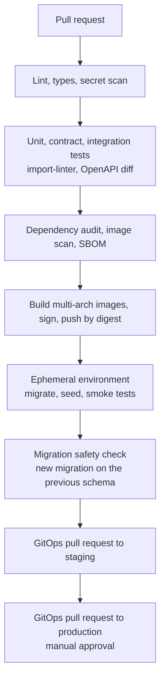

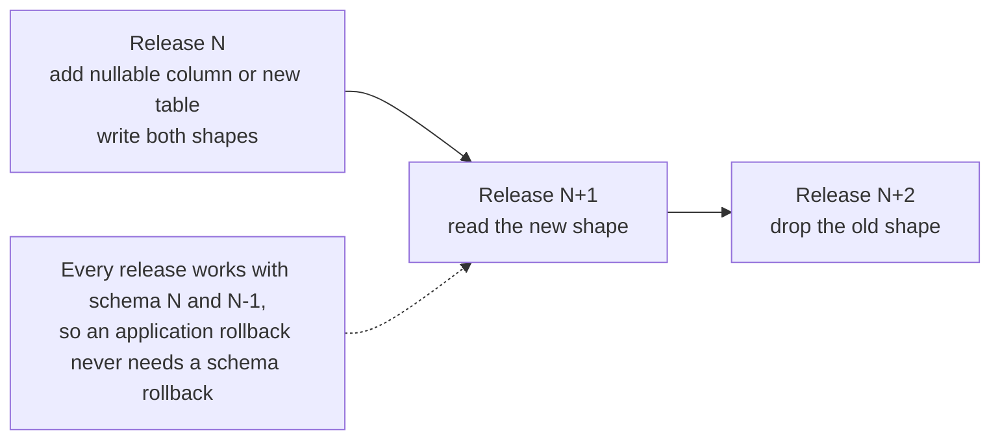

## 14. Trade-offs and rejected alternatives

| Decision | Chosen | Rejected | Reason |
|---|---|---|---|
| Architecture | Modular monolith | Microservices | Fewer moving parts; clear seams to split later |
| Queue | DB outbox, broker optional | Broker first | Atomicity with state; no extra infrastructure at this volume |
| Registry | Own domain model | MLflow as source of truth | Governance and audit must be owned |
| Concurrency | SQL constraints and compare-and-swap | Distributed locks | Simpler, correct, no extra system |
| Metrics storage | Partitioned SQL | Time-series DB first | Portable now; swap behind a port |
| Runtime | Simulated behind a port | Real serving platform | Time box, platform agnostic; contract tests keep it honest |
| UI updates | Polling with backoff | SSE or WebSocket | Simpler; same API can add SSE later |

Accepted limitations: the DB outbox has a throughput ceiling (mitigated by the broker adapter path); portability means Postgres-specific optimizations are kept in optional migrations; the simulated runtime proves the abstraction, not a real integration.

## 15. Related documents

- [API design](api-design.md)
- [Test strategy](test-strategy.md)
- [Answers to the assignment questions](questions.md)
- [ADRs](adr/)
- [Leadership artifacts](leadership/)
