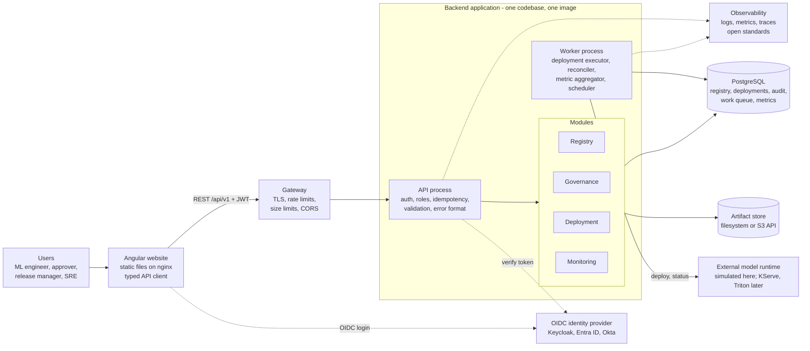
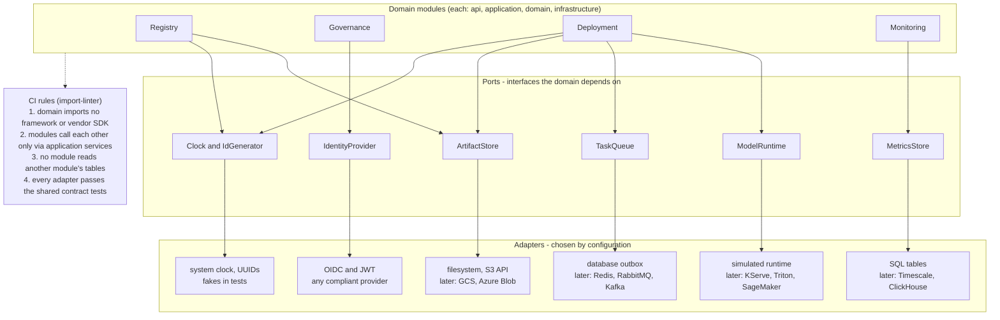
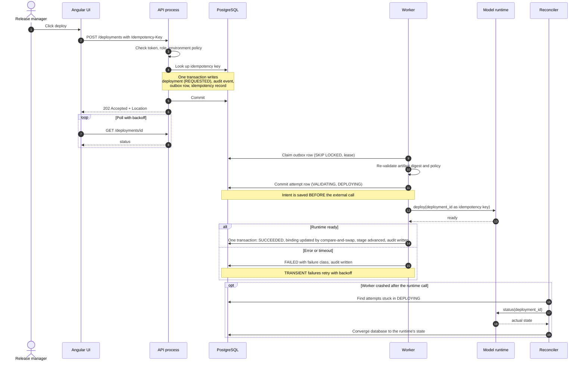
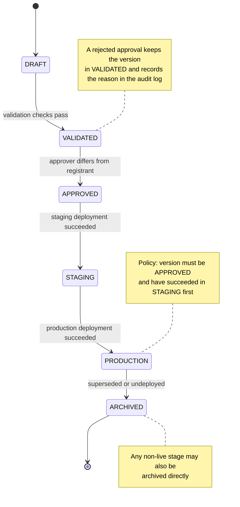
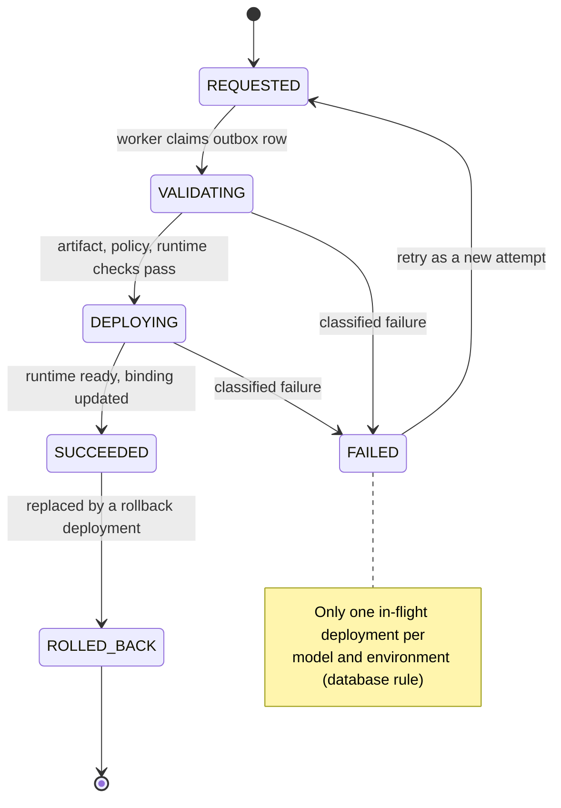
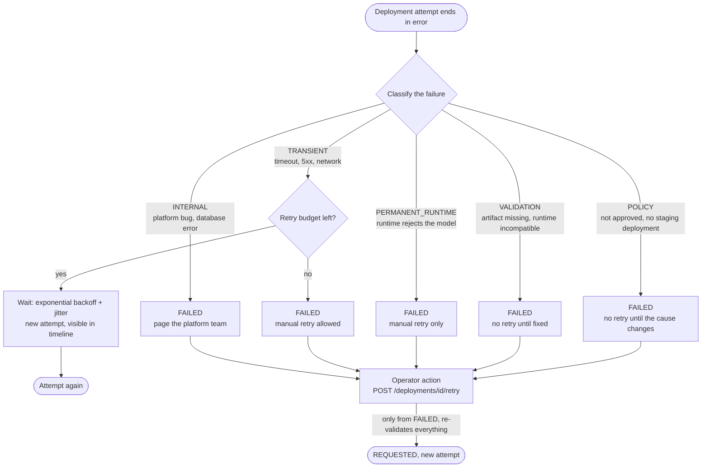
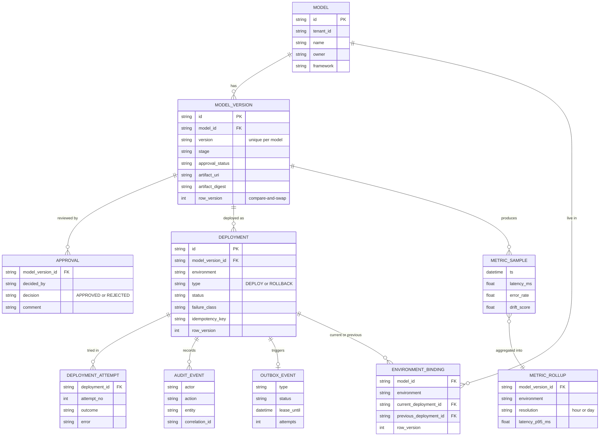
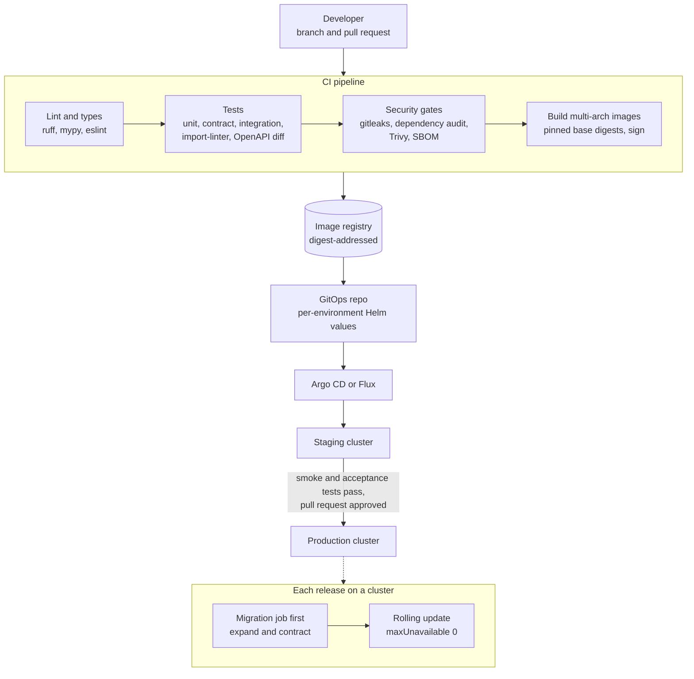

# Mermaid Diagrams

Diagram-as-code companions to the draw.io file ([`architecture.drawio`](architecture.drawio)). They render natively on GitHub and in most Markdown viewers, and they are easy to review in pull requests.

| # | Diagram | Answers |
|---|---|---|
| 1 | System overview | What are the main parts and how do they connect? |
| 2 | Modules, ports and adapters | How is the code organised and kept vendor neutral? |
| 3 | Deployment sequence | What happens, step by step, when someone deploys a model? |
| 4 | Version lifecycle | Which stage changes are allowed? |
| 5 | Deployment states | Which deployment status changes are allowed? |
| 6 | Failure handling | What happens to a failed deployment? |
| 7 | Data model | Which tables exist and how do they relate? |
| 8 | Delivery pipeline | How does code reach production? |

## 1. System overview

## 2. Modules, ports and adapters

The domain depends only on interfaces (ports). Configuration chooses the adapter, so there is no cloud or vendor specific code in business logic.

## 3. Deployment sequence

## 4. Version lifecycle

Stage is never edited directly. It changes as a result of a governance action or a deployment outcome.

## 5. Deployment states

## 6. Failure handling

## 7. Data model

Database rules that make this safe: unique `(model, version)`; a partial unique index allowing only one deployment in `REQUESTED`, `VALIDATING` or `DEPLOYING` per model and environment; unique `(tenant, actor, idempotency_key)`; unique binding per `(model, environment)`; audit table insert-only.

## 8. Delivery pipeline

