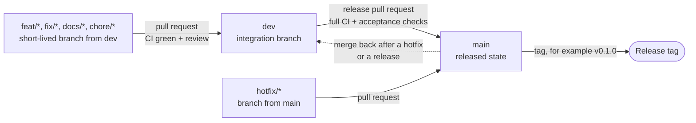
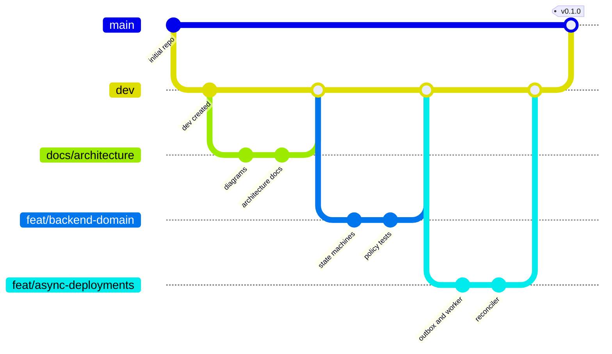

# Branching and Release Flow

Flow: **feature branch -> `dev` -> `main`**.

## Branch roles

| Branch | Purpose | Who merges into it | Stability |
|---|---|---|---|
| `main` | Released, presentable, always works. This is what an evaluator or production sees. | Only `dev` through a release pull request (or a hotfix) | Always green, always runnable with `docker compose up --build` |
| `dev` | Integration branch. Every finished feature lands here first and is tested together. | Feature branches through pull requests | Green in CI; may contain work not yet released |
| `feat/*`, `fix/*`, `docs/*`, `chore/*` | One focused change or milestone. Short-lived. | Author, then pull request into `dev` | Can be rough while in progress |
| `hotfix/*` | Urgent fix for something already on `main` | Pull request into `main`, then merged back into `dev` | Small and targeted |

## The flow



Example history for this project:



## Rules

1. **Never commit directly to `main` or `dev`.** Everything goes through a pull request.
2. **Start every feature from the latest `dev`.**
3. **Pull requests into `dev`:** CI must pass, and the [code-review checklist](code-review-checklist.md) is the PR template. Use a **squash merge** to keep `dev` readable, or a regular merge when the commit history itself is worth keeping (for example a TDD sequence).
4. **Release pull request `dev` into `main`:** use a **merge commit** so the release is one visible event. Only open it when `dev` is green and the acceptance scenarios pass against the Compose stack (`scripts/smoke_test.py`).
5. **Tag releases on `main`** (`v0.1.0`, `v0.2.0`, ...).
6. **After a hotfix to `main`,** merge `main` back into `dev` so the fix is not lost.
7. **Delete feature branches after merge.**
8. **Nothing is pushed or merged without the owner's explicit approval** (agreed working rule for this repository).

## Naming and commits

| Item | Convention | Example |
|---|---|---|
| Feature branch | `feat/<short-name>` | `feat/async-deployments` |
| Fix branch | `fix/<short-name>` | `fix/idempotency-replay` |
| Docs branch | `docs/<short-name>` | `docs/architecture` |
| Chore branch | `chore/<short-name>` | `chore/foundations` |
| Hotfix branch | `hotfix/<short-name>` | `hotfix/readiness-probe` |
| Commit message | `type: summary in the imperative` | `feat: add outbox claim with SKIP LOCKED` |
| Types | `feat`, `fix`, `docs`, `test`, `refactor`, `chore`, `ci` | |

Commit small and often. For domain logic, commit the failing test first and the implementation after it, so the history shows the test-first approach.

## Day-to-day commands

Start a feature:
```bash
git checkout dev
git pull
git checkout -b feat/backend-domain
```

Finish a feature (after approval to push):
```bash
git push -u origin feat/backend-domain
gh pr create --base dev --head feat/backend-domain --title "feat: backend domain model" --body "..."
gh pr merge --squash --delete-branch
```

Keep a feature branch current while you work:
```bash
git fetch origin
git rebase origin/dev        # or: git merge origin/dev
```

Release `dev` to `main` (after approval):
```bash
gh pr create --base main --head dev --title "release: v0.1.0" --body "Release notes..."
gh pr merge --merge          # merge commit; do NOT delete dev
git checkout main && git pull
git tag v0.1.0 && git push origin v0.1.0
```

Hotfix:
```bash
git checkout main && git pull
git checkout -b hotfix/readiness-probe
# fix, test, push, open PR into main, merge
git checkout dev && git pull
git merge origin/main        # bring the fix back into dev
```

## Protection settings (GitHub)

Recommended repository settings (Settings, Branches):

| Setting | `main` | `dev` |
|---|---|---|
| Require pull request before merging | yes | yes |
| Require status checks (CI) to pass | yes | yes |
| Require approvals | 1 if there is a second reviewer, otherwise off for a solo project | optional |
| Block force pushes and deletion | yes | yes |
| Restrict who can push | owner only | owner only |

For a solo assignment, "require approvals" would block you from merging your own pull requests, so leave it off and rely on the required CI checks plus self-review against the checklist.

## Trade-offs of this model

- **Benefit:** `main` stays clean and demonstrable. Integration problems show up on `dev`, not on `main`.
- **Cost:** two merges per change and a risk of `dev` and `main` drifting. Mitigate by releasing often and merging `main` back after hotfixes.
- **When to simplify:** if releases become continuous or there is only one environment, collapse to trunk-based development (feature branches straight into `main`) and drop `dev`.
