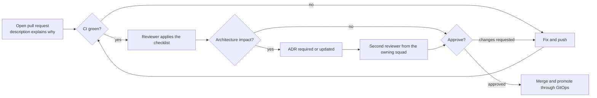

# Code Review Checklist

Use as the pull request template. Reviewers tick what applies and comment on what does not.

Review flow:

## Design and boundaries
- [ ] Change respects module boundaries (no cross-module table access; calls go through `application`).
- [ ] `domain` code imports no framework or vendor SDK.
- [ ] New infrastructure dependency sits behind a port, with an adapter and contract tests.
- [ ] Architecture-impacting change has an ADR or updates an existing one.
- [ ] Complexity is justified; a simpler option was considered.

## Correctness and data
- [ ] State changes go through the transition tables; invalid transitions raise typed errors.
- [ ] Multi-step writes are in one transaction (state, audit, outbox, idempotency).
- [ ] Concurrency considered: constraints, compare-and-swap, `409` behaviour.
- [ ] External calls are idempotent, with timeouts, bounded retries and failure classification.
- [ ] Migration is backward compatible (expand and contract) and reversible where possible.
- [ ] Tenant scoping applied to every query.

## API
- [ ] Request and response models are typed and validated.
- [ ] Errors use the standard envelope with correct status and code.
- [ ] Additive change only within `/api/v1`; OpenAPI diff is clean.
- [ ] Idempotency, pagination and filtering follow the conventions.

## Security
- [ ] Authorization checked server-side (role and environment policy).
- [ ] No secrets, tokens or personal data in code, logs or fixtures.
- [ ] Inputs validated; no string-built SQL; file and URL handling is safe.
- [ ] New dependency is necessary, maintained, pinned and scanned.

## Observability and operability
- [ ] Logs are structured and carry the correlation ID; no sensitive data logged.
- [ ] Metrics and health checks updated; no unbounded label cardinality.
- [ ] Failure paths produce actionable errors; alert or runbook updated if behaviour changed.
- [ ] Configuration comes from environment variables and is documented in `.env.example`.

## Tests
- [ ] Tests written first for domain logic; both success and failure paths covered.
- [ ] Concurrency or resilience test added for new async or shared-state behaviour.
- [ ] Tests are deterministic (fixed clock and IDs) and do not touch live systems.
- [ ] Angular: loading, empty, error and success states covered; services and interceptors tested.

## Frontend
- [ ] Uses the generated client and mappers; no direct knowledge of backend internals.
- [ ] RxJS subscriptions are cleaned up; polling stops on terminal states.
- [ ] Accessible markup (labels, focus order, contrast) and responsive layout checked.
- [ ] Errors show a clear message and the correlation ID.

## Delivery
- [ ] Commits are small and meaningful; PR description explains why, not only what.
- [ ] Docs updated (architecture, API, test strategy, README as needed).
- [ ] CI is green: lint, types, tests, scans, build.
- [ ] Rollback plan is clear for risky changes.
