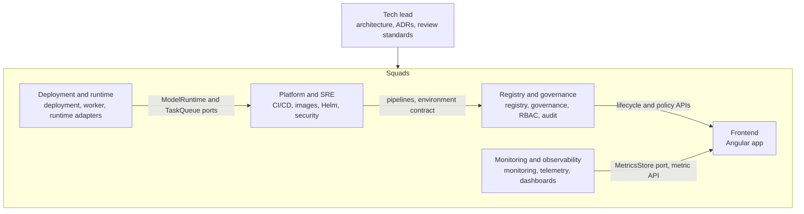
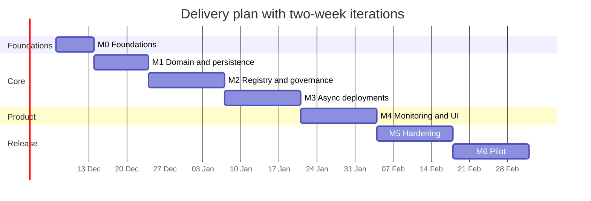

# Delivery Plan (small team)

Assumed team: 5 engineers (2 backend, 1 MLOps/platform, 1 frontend, 1 full-stack/tech lead), part-time product owner. Two-week iterations. The assignment submission itself is a single-engineer vertical slice; this plan shows how the same architecture scales to a team.

## Ownership

| Squad | Owns | Contract it publishes |
|---|---|---|
| Registry and governance | `registry`, `governance` modules, RBAC, audit | Lifecycle and policy application services, OpenAPI for registry and approvals |
| Deployment and runtime | `deployment` module, worker, runtime adapters | `ModelRuntime`, `TaskQueue` ports and contract tests |
| Monitoring and observability | `monitoring` module, telemetry, dashboards | `MetricsStore` port, metric API, `ops/` dashboards and alerts |
| Frontend | Angular app | Consumes the OpenAPI contract; publishes UI error and state patterns |
| Platform/SRE (shared) | CI/CD, images, Helm, security, runbooks | Pipelines, environment contract, production-readiness checklist |

The tech lead owns the architecture, ADRs, the code-review checklist and cross-module decisions.

## Milestones

| Milestone | Weeks | Outcome | Exit criteria |
|---|---|---|---|
| M0 Foundations | 1 | Repo, tooling, CI skeleton, docs and ADRs, Compose with database | `make test lint` green; ADR-001 to 004 reviewed |
| M1 Domain and persistence | 1 to 2 | State machines, policy, migrations, seed loader | Domain unit tests green; seed loads idempotently |
| M2 Registry and governance | 3 to 4 | Models, versions, approvals, RBAC, audit, error envelope | Acceptance scenarios 1 to 3 pass |
| M3 Async deployments | 5 to 6 | Outbox, worker, simulated runtime, idempotency, retry, rollback, reconciler | Scenarios 4, 6, 7, 8; concurrency and crash tests green |
| M4 Monitoring and UI | 7 to 8 | Metric ingest and API, Angular views with all states | Scenarios 5 and 9; component tests green |
| M5 Hardening | 9 to 10 | Observability, security baseline, load baseline, restore drill, runbooks | Production-readiness checklist at least 90% complete |
| M6 Pilot | 11 to 12 | First plant pilot, feedback, real runtime adapter spike | Pilot SLOs met for two weeks |

Squads and the contracts they publish:

Milestone timeline (dates are illustrative):

## Working agreements

- Branching: short-lived feature branches merge into `dev` through pull requests; `dev` is promoted to `main` through a release pull request. `main` only ever receives code from `dev` (or a hotfix). See [branching and release flow](branching-and-release-flow.md). At least one reviewer; the [code-review checklist](code-review-checklist.md) is the PR template.
- Definition of done: tests written first for domain logic, docs and OpenAPI updated, migration is backward compatible, dashboards and alerts updated for new behaviour.
- Architecture changes need an ADR. Cross-module changes need both owning squads to review.
- Every release is a signed image digest promoted through environments by pull request.

## Critical path and dependencies

1. Lifecycle and deployment state machines (everything depends on them).
2. Persistence and migrations.
3. Outbox and worker (deployment features depend on it).
4. OpenAPI contract stabilized early so the frontend can work in parallel with generated mocks.

## Scope control

If the schedule slips, cut in this order: OpenTelemetry tracing, Playwright end-to-end tests, full RBAC (keep a minimal role check), Helm and ops depth (keep as documented design). Never cut: approval gate, async deployment, idempotency, rollback safety, ADRs.
