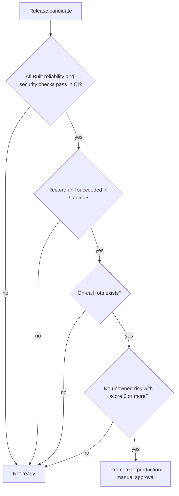

# Production Readiness Checklist

Current state: design baseline only. Nothing below is implemented yet. The "Delivery target" column says what this repository will deliver; change it to a status (done, partial, not done) as the implementation progresses.

Legend: **Built** = will be implemented and tested in the repository. **Designed** = documented design or skeleton, not proven in production. **Future** = roadmap item.

## Architecture and design
| Item | Delivery target |
|---|---|
| Architecture document, diagrams and ADRs reviewed | Built |
| Module boundaries enforced in CI | Built |
| Ports have contract tests | Built |
| Threat model (STRIDE) reviewed | Designed |

## Reliability
| Item | Delivery target |
|---|---|
| Asynchronous deployment with outbox, leases and reconciler | Built |
| Idempotency and concurrency control tested against real PostgreSQL | Built |
| Timeouts, bounded retries, backoff with jitter, circuit breaker around the runtime | Built |
| Graceful shutdown and readiness-gated traffic | Built |
| 2+ replicas, PodDisruptionBudget, anti-affinity | Designed |
| HA database with automatic failover | Designed |
| Backups with point-in-time recovery; restore drill passes | Designed |
| RPO 5 minutes or less and RTO 1 hour or less demonstrated | Designed |

## Security
| Item | Delivery target |
|---|---|
| OIDC and JWT validation; RBAC with separation of duties | Built (minimal), Designed (full IdP) |
| Tenant isolation tested | Built |
| No secrets in Git; `.env.example` only; secret store in deployment | Built / Designed |
| Non-root containers, read-only root filesystem, dropped capabilities | Built |
| NetworkPolicies default deny | Designed |
| Dependency, image and secret scanning in CI; SBOM; signed images | Built (scans), Designed (signing) |
| Artifact digest verified at deploy time | Built |

## Observability
| Item | Delivery target |
|---|---|
| Structured logs with correlation IDs | Built |
| Prometheus metrics, health and readiness endpoints | Built |
| OpenTelemetry tracing | Designed (optional) |
| Dashboards and alert rules in Git | Designed |
| SLOs and burn-rate alerts defined | Designed |
| Runbooks: stuck deployment, outbox lag, DB failover, failed migration, bad release, restore, secret rotation | Designed |

## Data and migrations
| Item | Delivery target |
|---|---|
| Migrations idempotent, forward-only, expand and contract | Built |
| Previous release passes tests on the new schema (CI) | Built |
| Retention for raw metrics, idempotency records and outbox | Built |
| Metrics partitioning and rollups | Built / Designed |

## Delivery
| Item | Delivery target |
|---|---|
| Locked dependencies, pinned base image digests | Built |
| One image promoted across environments by digest | Designed |
| `docker compose up --build` works on a clean clone | Built |
| Helm chart installs on a plain Kubernetes cluster | Designed |
| CI runs lint, types, tests, scans and a smoke test | Built |

## Operations and governance
| Item | Delivery target |
|---|---|
| On-call ownership and escalation defined | Designed |
| Incident and post-incident review process | Designed |
| Capacity and load baseline documented | Built (baseline) |
| Known limitations documented | Built |
| Roadmap and risk register current | Built |

## Go-live gate
Do not promote to production unless: all **Built** items for reliability and security pass in CI, the restore drill has succeeded in staging, the on-call rota exists, and the risk register has no unowned score of 6 or more.

