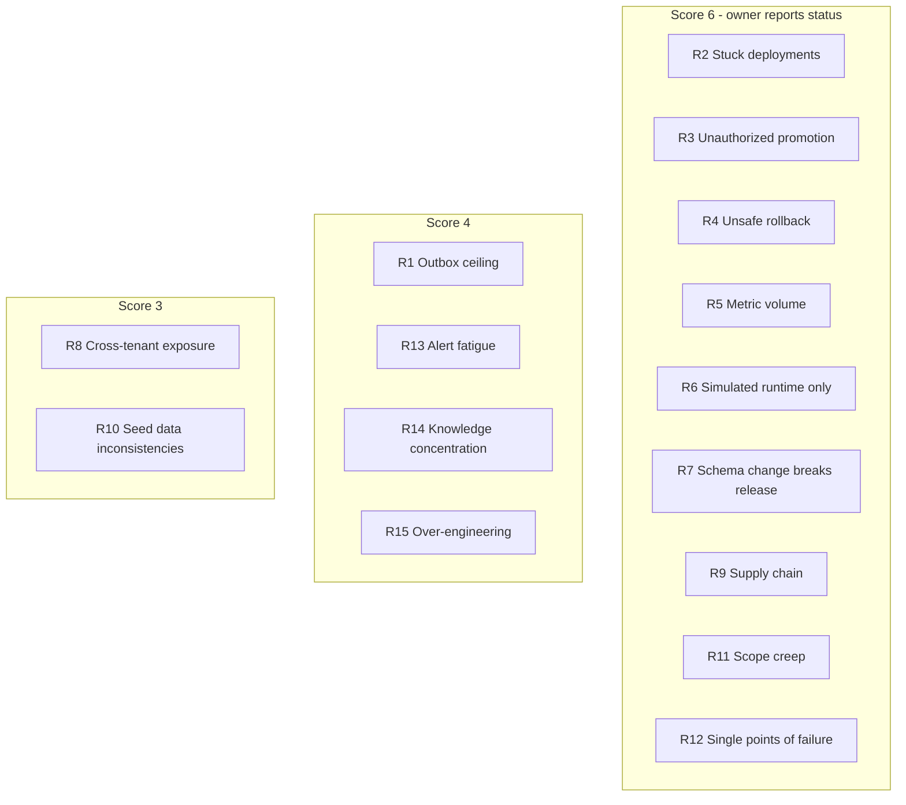
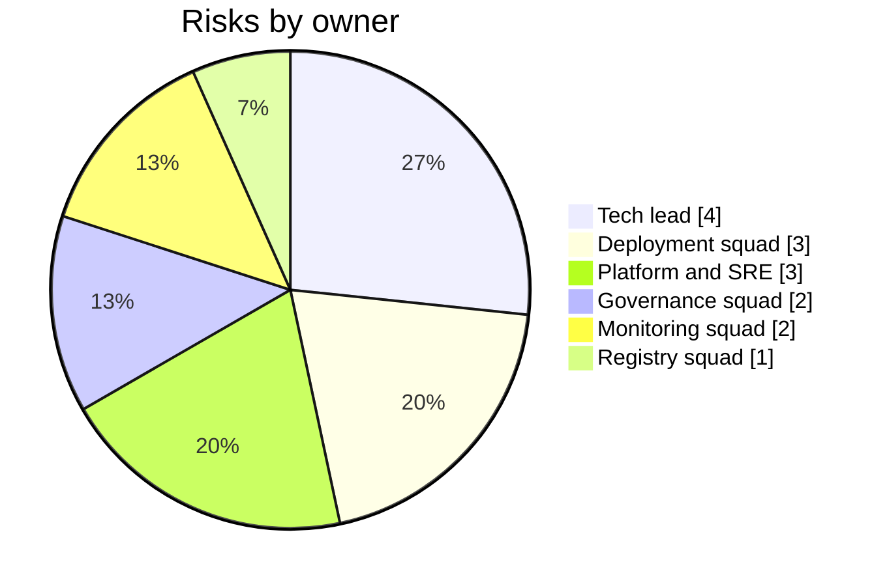

# Risk Register

Likelihood (L) and impact (I): 1 low, 3 high. Score = L x I.

| ID | Risk | L | I | Score | Mitigation | Owner | Trigger / early warning |
|---|---|---|---|---|---|---|---|
| R1 | DB outbox throughput ceiling at large scale | 2 | 2 | 4 | `TaskQueue` port, broker adapter path, partitioned outbox, `SKIP LOCKED` workers, `outbox_lag_seconds` alert | Deployment squad | Outbox lag rising under normal load |
| R2 | Deployments stuck after partial failure | 2 | 3 | 6 | Attempt row before external call, idempotent runtime key, reconciler, stuck-deployment alert and runbook | Deployment squad | Stuck count above zero for longer than the timeout |
| R3 | Unauthorized or accidental production promotion | 2 | 3 | 6 | RBAC, separation of duties, per-environment policy, server-side checks, audit, production approval | Governance squad | Promotion without approval event in audit |
| R4 | Unsafe rollback to a bad or archived version | 2 | 3 | 6 | Rollback preconditions, digest verification, compare-and-swap, tests | Deployment squad | `UNSAFE_ROLLBACK` rate spike |
| R5 | Metric volume overwhelms the database | 2 | 3 | 6 | Time partitions, rollups, retention, ingest batching and limits, `MetricsStore` port to a time-series store | Monitoring squad | Ingest latency, table size growth |
| R6 | Only a simulated runtime is proven; real integration surprises | 3 | 2 | 6 | Contract tests per port, early real-adapter spike (M6), capability checks | Tech lead | Spike finds missing capability |
| R7 | Schema change breaks a running release | 2 | 3 | 6 | Expand and contract, migration compatibility test in CI, N and N-1 support | Platform/SRE | Compatibility job fails |
| R8 | Cross-tenant data exposure | 1 | 3 | 3 | Tenant scoping in repositories, row-level security, tenant isolation tests | Governance squad | Any isolation test failure |
| R9 | Supply-chain compromise or vulnerable dependency | 2 | 3 | 6 | Locked dependencies, pinned digests, scanning, SBOM, signing, update PRs | Platform/SRE | Scan failure, advisory |
| R10 | Seed data inconsistencies cause confusing demos or tests | 3 | 1 | 3 | Idempotent seed loader that reconciles orphan models; documented in `data/README.md` | Registry squad | Foreign key errors on seed |
| R11 | Scope creep before core flows are solid | 3 | 2 | 6 | Fixed cut order, vertical slice first, milestone exit criteria | Tech lead | Core scenarios not green at milestone end |
| R12 | Single points of failure (database, gateway) | 2 | 3 | 6 | HA database with failover, 2+ replicas, PDBs, restore drills | Platform/SRE | Failed failover or restore drill |
| R13 | Alert fatigue hides real incidents | 2 | 2 | 4 | Failure classification routes alerts; burn-rate alerts instead of raw thresholds | Monitoring squad | Pages ignored or muted |
| R14 | Knowledge concentration in one engineer | 2 | 2 | 4 | ADRs, runbooks, module ownership pairs, reviews | Tech lead | Single reviewer on many PRs |
| R15 | Over-engineering delays delivery | 2 | 2 | 4 | Non-goals list, ADR rationale required for added components | Tech lead | New infrastructure proposed without an ADR |

Risks by score:

Risks by owner:

Review cadence: at every milestone exit and after any incident. Scores of 6 or more need an owner-reported status.
