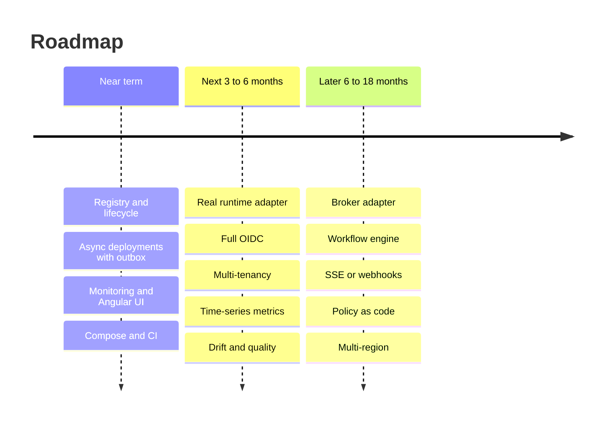
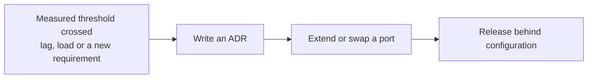

# Roadmap

## Near term (assignment and first release)

| Theme | Items |
|---|---|
| Core platform | Registry, lifecycle state machine, approval and promotion policy, audit history |
| Deployments | Asynchronous deployment via outbox, idempotency, retry, rollback, reconciler, simulated runtime with failure injection |
| Monitoring | Metric ingest, rollups, status evaluation, version comparison |
| UI | Model inventory, version details, deployments, monitoring dashboard, event timeline, all UI states |
| Operability | Structured logs with correlation IDs, Prometheus metrics, health and readiness, Docker Compose, CI with scans |
| Design only (documented, skeleton) | Helm chart, GitOps layout, dashboards and alert rules, runbooks, STRIDE threat model, backup and restore drill |

## Next (3 to 6 months)

| Theme | Items | Trigger |
|---|---|---|
| Real runtime adapter | KServe or Triton adapter, capability negotiation, canary and blue-green strategies | First plant pilot |
| Identity | Full OIDC integration with the corporate IdP, group-to-role mapping, per-tenant roles | Production rollout |
| Multi-tenancy | Tenant quotas, row-level security, fair queueing | Second business unit onboarded |
| Metrics scale | Time-series store adapter (Timescale or ClickHouse), downsampling policy | Raw ingest above agreed threshold |
| Drift and quality | Statistical drift tests, alert thresholds per model, retraining triggers (events only) | Data science request |
| Registry integration | MLflow import adapter, artifact digest verification at scale | Teams already on MLflow |
| Operability | OpenTelemetry tracing everywhere, SLO dashboards and burn-rate alerts live, scheduled restore drills | Production readiness |

## Later (6 to 18 months)

| Theme | Items |
|---|---|
| Throughput | Broker adapter (Redis, RabbitMQ or Kafka) for the queue if outbox limits are reached |
| Workflow | Evaluate a workflow engine (Temporal, Argo Workflows) for multi-step approvals and staged rollouts |
| Platform | Event streaming API (SSE or webhooks) so the UI and integrations do not poll |
| Governance | Policy as code (OPA), change windows, dual approval for production |
| Regions | Multi-region read replicas, regional runtime pools, data residency controls |
| Service split | Split `monitoring` into its own service if it needs independent scaling or ownership |
| Cost and capacity | Per-model cost attribution, autoscaling recommendations |

How a roadmap item gets pulled forward:

## Principles for roadmap decisions
- Prefer extending a port over adding a new system.
- Add infrastructure only when a measured threshold is crossed, and record the decision in an ADR.
- Keep the control plane independent of the data plane.
