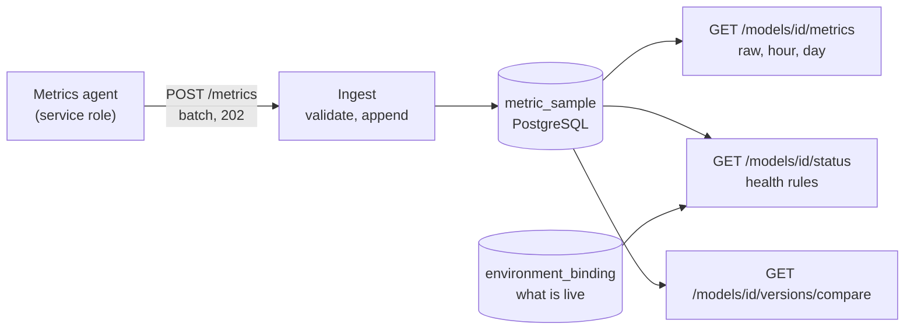

# Monitoring: ingest, series, health and comparison

How the platform receives metrics from running models and decides whether a model is healthy.
The endpoints are listed in [api-design.md](api-design.md). This page states the rules, so an
operator can predict what the platform will say.

## Ingest

- `POST /api/v1/metrics` with `{"samples": [...]}`. Needs the `service` role (or `admin`).
- Each sample names a model, version and environment, a timestamp with a time zone, and six values:
  `latency_ms` (0 and up), `throughput_rpm` (0 and up), `error_rate` (0 to 1), `quality_score`
  (0 to 1), `drift_score` (0 and up), `availability` (0 to 100).
- **All or nothing.** One invalid or unknown sample rejects the whole batch. The error names it,
  for example `samples[3].error_rate`, so the agent can fix and resend.
- **Safe to resend.** A sample is identified by model, version, environment and timestamp. Samples
  already stored are counted as `duplicates`, not stored twice.
- A timestamp more than 5 minutes in the future is refused (clock skew allowance).
- A batch holds at most `METRICS_MAX_BATCH` samples (default 1000).
- Ingest writes no audit entry per sample: the volume would bury the audit trail. The request is
  still logged with its correlation ID.

## Series

`GET /api/v1/models/{id}/metrics?version=&environment=&from=&to=&resolution=`

- `resolution=raw` returns each sample. `hour` and `day` return the **mean** per UTC bucket, with
  the number of samples behind each point.
- Default range when `from`/`to` are omitted: 24 hours (raw), 7 days (hour), 30 days (day).
- The response includes a summary: count, min, max and mean per metric, and p95 latency (nearest
  rank).
- A range that holds more than `METRICS_MAX_SERIES_ROWS` samples is refused with a message to
  narrow it. The platform never silently truncates a chart.
- An empty range is a normal `200` with no points and a null summary.

## Health status

`GET /api/v1/models/{id}/status` evaluates every version that is live or has reported metrics,
per environment.

| Status | Meaning |
|---|---|
| `NO_DATA` | A live version has never reported, or the model has nothing live and no data. |
| `STALE` | The newest sample is older than `HEALTH_STALE_AFTER_SECONDS` (default 24 hours). Silence is not health, however good the last numbers were. |
| `HEALTHY` | Fresh data and no limit crossed. |
| `DEGRADED` | At least one metric crossed its degraded limit. |
| `CRITICAL` | At least one metric crossed its critical limit. |

The metrics are averaged over the **window** ending at the newest sample (default 1 hour,
`HEALTH_WINDOW_SECONDS`), so one spike does not flip the status. Default limits:

| Metric | Degraded | Critical |
|---|---|---|
| `error_rate` | 0.02 or more | 0.05 or more |
| `latency_ms` | 200 or more | 500 or more |
| `drift_score` | 0.30 or more | 0.50 or more |
| `quality_score` | below 0.80 | below 0.70 |
| `availability` | below 99.0 | below 95.0 |

Every breach is returned as a reason with the metric, the averaged value, the threshold and a
sentence an operator can read.

**What decides the model's status.** Only live versions. A superseded version that has gone quiet
is expected, so it appears in `items` with `live: false` but does not change the model's status.
If several live versions disagree, the most urgent wins: `CRITICAL`, then `DEGRADED`, `STALE`,
`NO_DATA`, `HEALTHY`.

`last_sample_at` is the time of the newest sample: the last sign the model was serving. The
platform does not see individual inferences.

## Comparing versions

`GET /api/v1/models/{id}/versions/compare?a=&b=&environment=` returns both versions' metadata
(stage, approval, algorithm, artifact, tags, registration details) and their metric means, plus
`deltas`: the change from `a` to `b` per metric, in absolute terms and as a percentage (null when
the baseline is zero). With no range, all available samples are used. If either side has no
samples, `deltas` is null rather than invented.

## Known limitations

- Thresholds are one default set. Per-model thresholds are on the roadmap.
- Series are aggregated in application code from raw rows, bounded by `METRICS_MAX_SERIES_ROWS`.
  Rollup tables and monthly partitions are a PostgreSQL-only follow-up (architecture.md, section 11).
- Health is computed when asked, not stored, so there is no status history and no alerting yet.
- The seed data ends in July 2026, so after 24 hours of real time every seeded model reads `STALE`.
  That is the rule working, not a bug. Send fresh samples to see `HEALTHY`.
