# Answers to the Assignment Questions

References point to [architecture.md](architecture.md) and the [ADRs](adr/).

## G12 questions

### 1. How would this scale from 100 to 10,000 models?
Everything on the request path is stateless, so API replicas scale horizontally. Workers scale on queue depth. The outbox sustains the expected deployment rate (about one per minute at 10,000 models) with large headroom; if sustained load grows, a broker adapter replaces the polling consumer while the outbox keeps atomicity. The real volume is metrics (about 29 million rows per day under stated assumptions): monthly partitions, hourly and daily rollups, short raw retention, then a time-series store behind `MetricsStore`. Reads use keyset pagination, read replicas and ETag caching; PgBouncer protects connection limits. See architecture section 11.

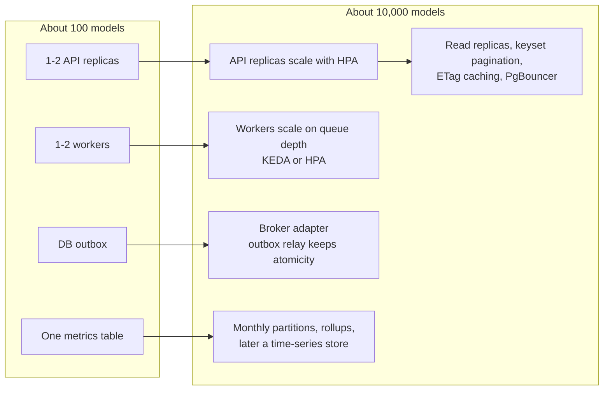

### 2. How are conflicting promotions prevented?
Two database-level guards: a partial unique index allows only one in-flight deployment per tenant, model and environment, and compare-and-swap on `row_version` protects bindings and versions. The loser gets a deterministic `409` naming the winning deployment. See ADR-003.

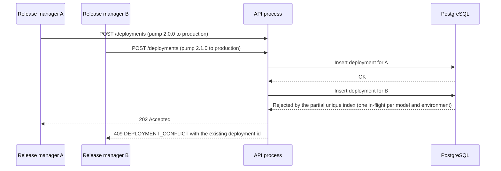

### 3. How is external success versus internal database failure reconciled?
Intent is committed before the side effect (the attempt row). The runtime call is idempotent on `deployment_id`. If the worker dies between the runtime call and the result commit, the reconciler finds attempts stuck in `DEPLOYING`, asks `ModelRuntime.status(deployment_id)`, and converges the database to reality. State change and outbox event share one transaction, so there is no dual write. See ADR-002 and architecture 7.2.

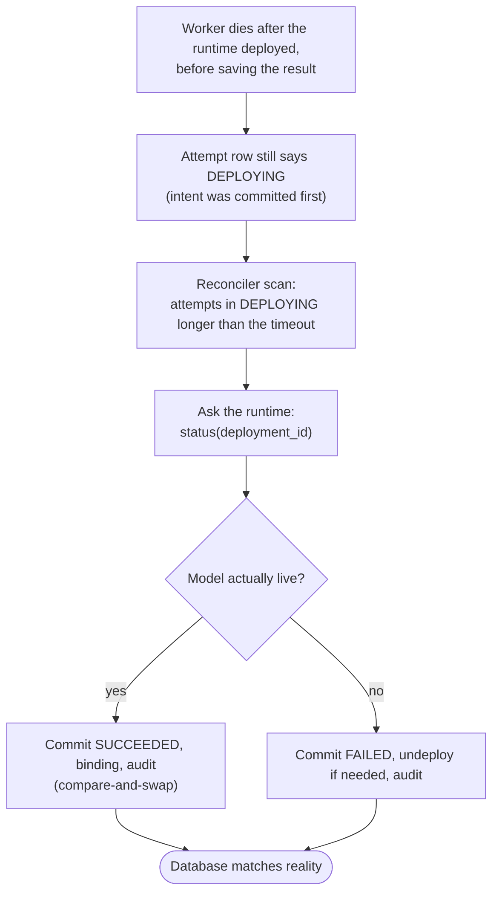

### 4. How are multiple model runtimes supported?
`ModelRuntime` is a port with `deploy`, `status`, `undeploy` and `capabilities`. A model version declares a `runtime_type`; configuration maps runtime types to adapters (simulated, KServe, Triton, SageMaker, Vertex). Every adapter must pass the same contract test suite. Validation checks capability compatibility before deploying and before rollback.

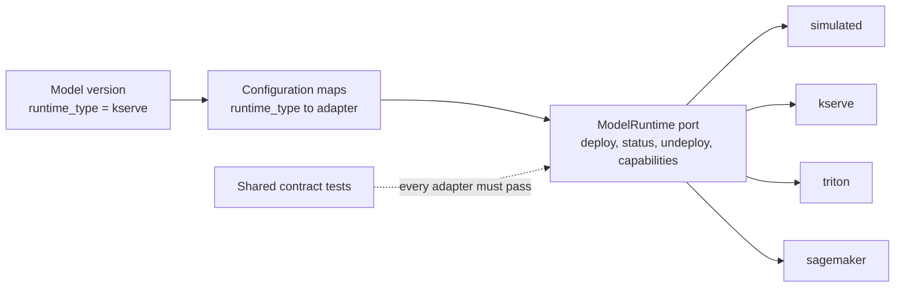

### 5. How would multi-tenancy work?
`tenant_id` is on every table and in every unique key and comes from the validated token. Repositories add the tenant filter, and PostgreSQL row-level security is defense in depth. Per-tenant quotas and rate limits prevent noisy neighbours, and the queue schedules fairly across tenants. Isolation can step up from shared schema to schema-per-tenant to database-per-tenant without changing the API.

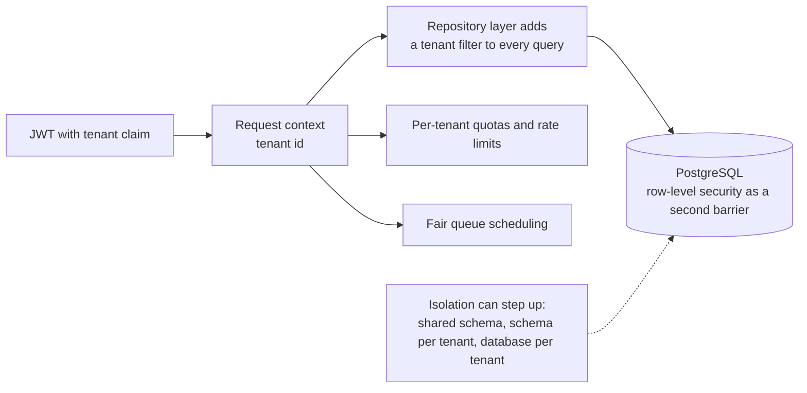

### 6. How are large metric volumes partitioned?
Time-partitioned tables (monthly) with an index on `(tenant, model, version, environment, ts)`. Rollup jobs write hourly and daily aggregates; dashboards query rollups for long ranges and raw data only for short ranges. Raw retention is short and configurable. Beyond a threshold, `MetricsStore` is swapped for Timescale, ClickHouse or Prometheus remote-write.

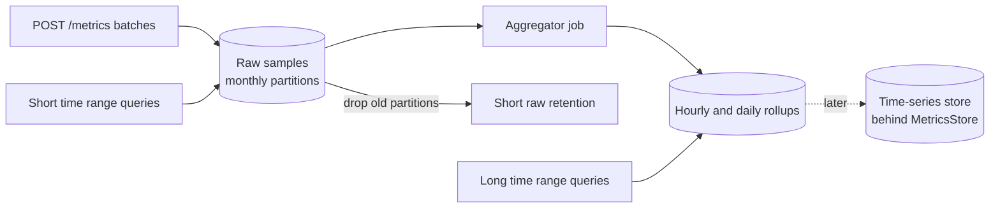

### 7. How is unsafe rollback prevented?
Rollback is a validated, audited deployment. In one transaction the platform checks that a previous deployment exists in the same environment, that the target version is approved and not archived or rejected, that its artifact digest still verifies, that the runtime is compatible, and that nothing else is in flight. The binding swap uses compare-and-swap, so a concurrent rollback loses with `409 UNSAFE_ROLLBACK` or `STALE_VERSION`. Production rollback needs role `release-manager`.

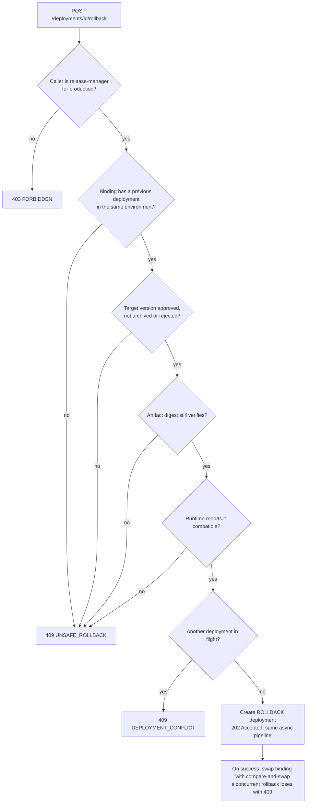

### 8. How are zero-downtime schema migrations handled?
Expand and contract. Release N adds nullable columns or new tables and writes both shapes. Release N+1 reads the new shape. Release N+2 removes the old one. Migrations run as a separate pre-upgrade job, every release supports schema N and N-1, and CI applies the new migration on the previous schema and runs the previous release's tests.

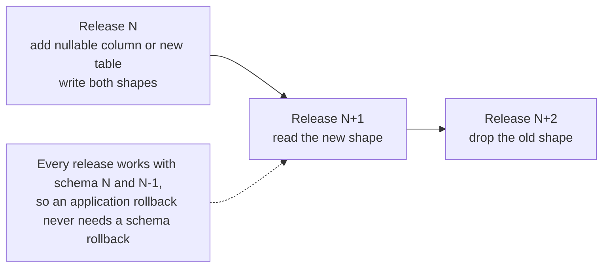

### 9. How is Angular isolated from backend internals?
Through the versioned OpenAPI contract and a generated typed client. DTOs are mapped to view models in one layer, the UI never imports backend code, and one interceptor normalizes errors into a UI error type with the correlation ID. The API base URL is runtime configuration, so the same image runs everywhere.

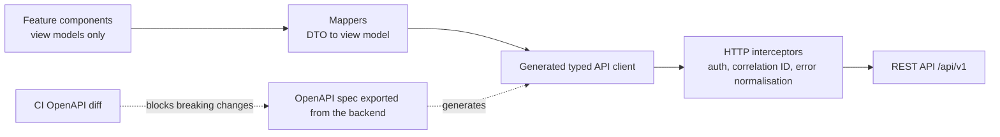

### 10. How would work be split across teams?
By module ownership. Registry and governance, deployment and runtime, monitoring and observability, frontend, and platform/SRE each own a module and its contract (lifecycle and policy APIs, `ModelRuntime` and `TaskQueue`, `MetricsStore`, the OpenAPI spec, the Helm chart and pipelines). Import-linter and contract tests keep boundaries honest. See [delivery plan](leadership/delivery-plan.md).

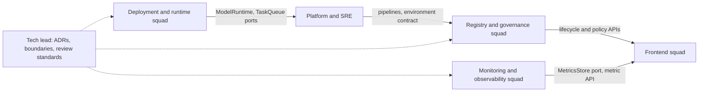

## G13 questions (covered for completeness)

### Why was the framework selected?
FastAPI gives typed request and response models, validation and OpenAPI generation from the same code, async support and a strong test client. That makes the contract with the Angular client a by-product of the code.

### How are domain entities represented?
As plain Python domain objects in each module's `domain` layer, independent of the ORM. SQLAlchemy models live in `infrastructure` and are mapped to and from domain objects. Pydantic models describe the API only.

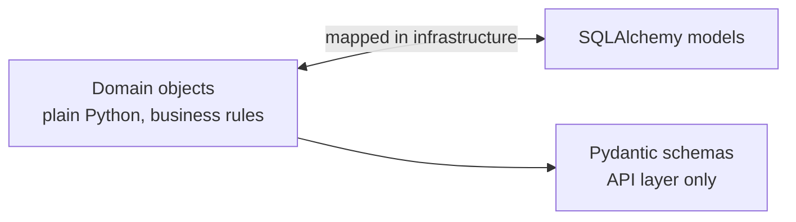

### How are invalid lifecycle transitions prevented?
By explicit transition tables in the domain layer with guards (approver role and separation of duties, staging precondition, rollback safety). Invalid transitions raise typed domain errors mapped to `409 INVALID_TRANSITION`. Stage changes only happen as results of governance actions or deployment outcomes, never by direct field edits. Unit tests cover every allowed and forbidden transition.

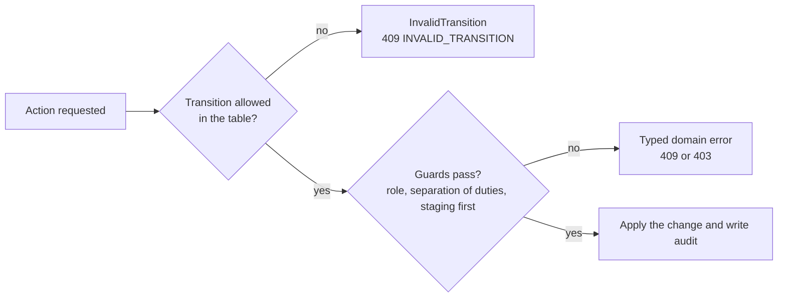

### How are API errors standardized?
One RFC 7807 style envelope with `code`, `title`, `detail`, `details` and `correlation_id`, produced by global exception handlers. Domain errors, validation errors and unexpected errors all map to it. See [api-design.md](api-design.md).

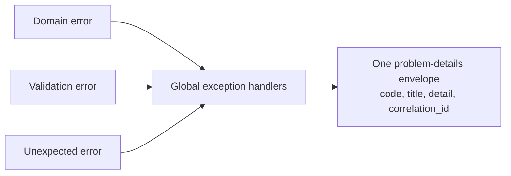

### How does Angular handle loading and failure?
Every data view uses the same state components for loading, empty, success and error. HTTP calls go through a generated client; an interceptor normalizes errors and adds the correlation ID, and views show a retry action and the reference. Polling for deployments uses RxJS with backoff and stops at terminal states.

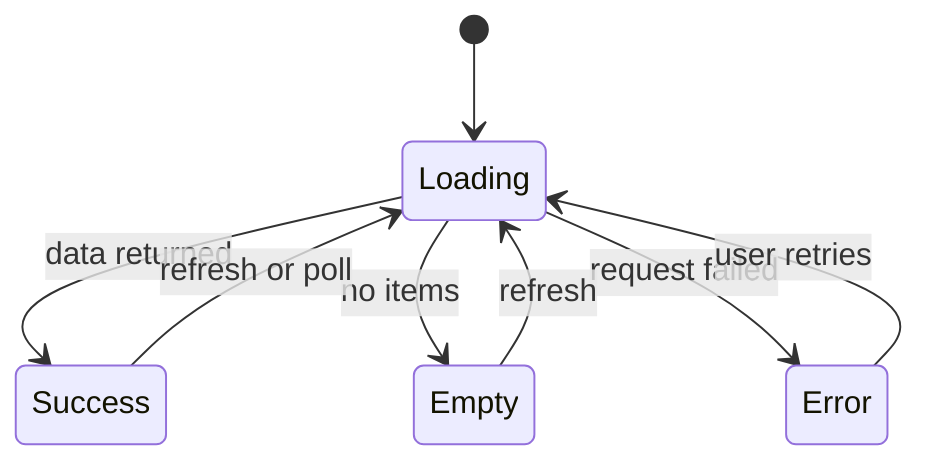

### How are tests isolated from live systems?
Fakes and the simulated adapters stand in for the runtime, artifact store and identity provider; the clock and ID generator are injected; integration tests use a disposable PostgreSQL; nothing in tests calls a cloud service. See [test-strategy.md](test-strategy.md).

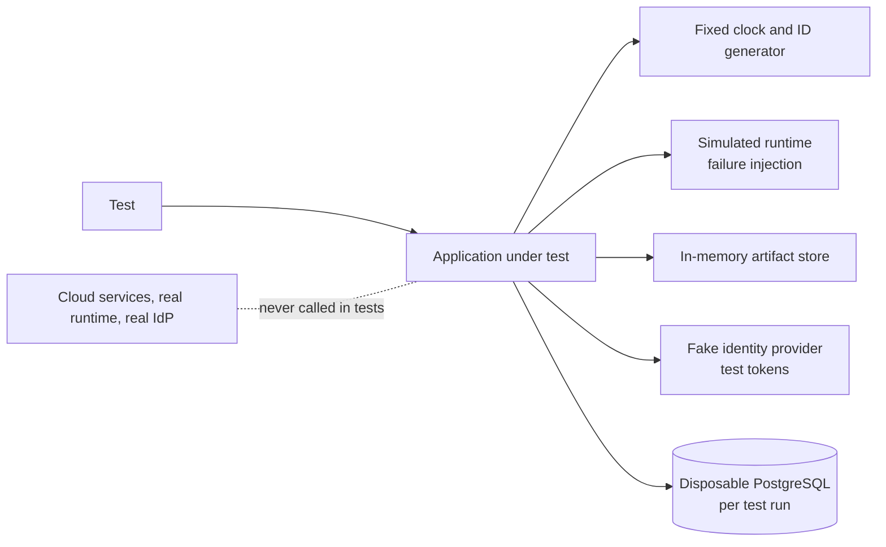

### How is configuration managed?
Twelve-factor: every setting is an environment variable validated at startup by `pydantic-settings`, failing fast if invalid. `.env.example` documents all variables and CI checks it against the settings schema. Secrets come from the platform secret store. Adapter selection is configuration (`RUNTIME_BACKEND`, `QUEUE_BACKEND`, and so on). The frontend reads a runtime `config.json`.

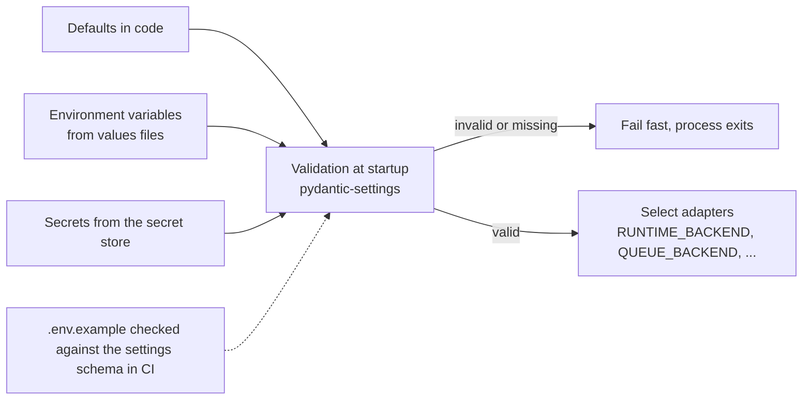

### How would the design extend to a real serving platform?
Implement the `ModelRuntime` port for the target (for example KServe), declare its capabilities, run the shared contract tests against it, and select it by configuration. Deployment workflow, reconciliation, rollback and monitoring are unchanged because they depend only on the port.

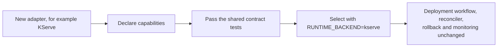
