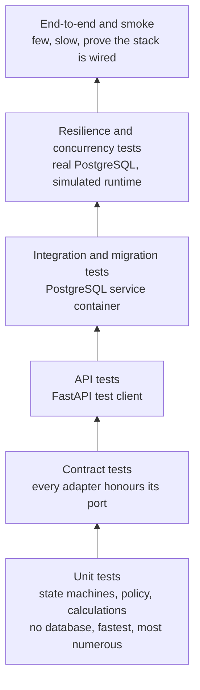
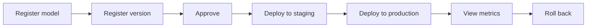
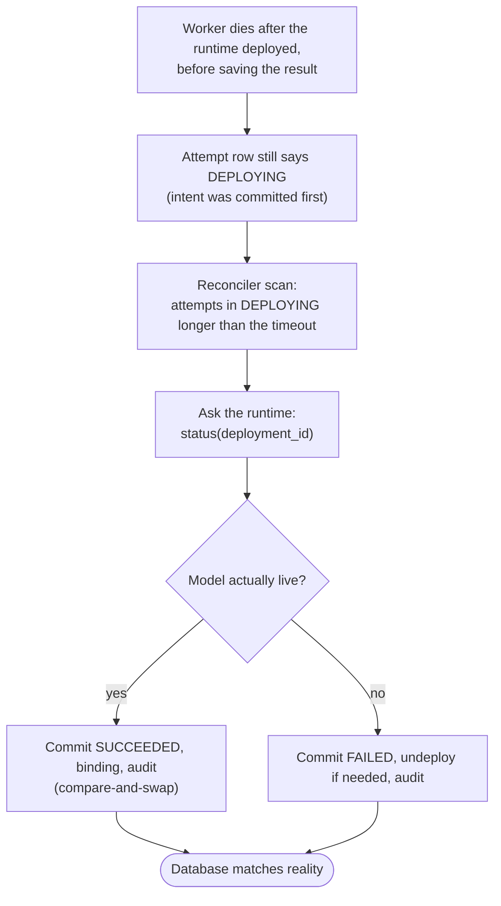
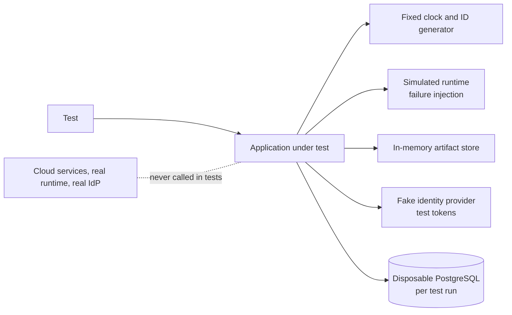
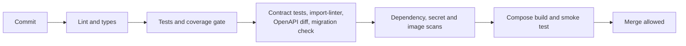

# Test Strategy

Principle: test behaviour at the cheapest level that can prove it. Business rules are proven without a database; concurrency and persistence are proven on a real PostgreSQL; the end-to-end scenario proves the system is wired together. Tests are deterministic: fixed clock, fixed ID generator, seeded data, no network access outside the test containers.

## Test pyramid

| Level | Location | Runs on | What it proves |
|---|---|---|---|
| Unit | `backend/tests/unit` | in-memory | Lifecycle and deployment transition tables, approval and promotion policy, rollback rules, failure classification, metric status calculation, idempotency key hashing |
| Contract | `backend/tests/contract` | in-memory and real services | Every adapter honours its port: `ModelRuntime`, `TaskQueue`, `ArtifactStore`, `MetricsStore`, `IdentityProvider` |
| API | `backend/tests/api` | FastAPI test client, test database | Success, validation errors, missing records, conflicts, duplicates, authorization, error envelope, correlation ID |
| Integration | `backend/tests/integration` | PostgreSQL service container | Persistence, migrations, idempotency, concurrency, outbox claiming, retry, rollback, metrics queries |
| Resilience | `backend/tests/resilience` | PostgreSQL, simulated runtime | Crash after external success, crash before attempt commit, duplicate claim, runtime timeout, reconciler repair |
| Angular unit | `frontend/src/**/*.spec.ts` | Jest or Karma | Components, services, interceptors, loading, empty, success and error states, form validation, RxJS polling stops on terminal state |
| End-to-end | `frontend/e2e` and `scripts/smoke_test.py` | Docker Compose stack | The acceptance scenario below |
| Architecture | CI step | static | import-linter contracts (module boundaries, domain purity) |
| Migration | CI step | PostgreSQL | Forward migration on populated data; previous release's tests pass on the new schema (expand and contract) |

Test pyramid (bottom is cheapest and most numerous; top is most realistic and slowest):

## Scenarios mapped to the assignment

| # | Acceptance scenario | Primary level |
|---|---|---|
| 1 | Register a model and two versions | API, integration |
| 2 | Approve one version (approver differs from registrant) | unit, API |
| 3 | Unapproved version blocked from Production | unit, API, resilience (worker re-check) |
| 4 | Deploy an approved version asynchronously (`202`, then `SUCCEEDED`) | integration, E2E |
| 5 | Monitoring data visible in Angular | Angular unit, E2E |
| 6 | Retry a failed deployment | integration, unit |
| 7 | Roll back a Production deployment, including unsafe rollback refusal | integration, unit |
| 8 | Duplicate deployment requests are safe | integration (parallel requests) |
| 9 | API failures are shown clearly in the UI | Angular unit, E2E |
| 10 | Critical workflows covered by automation | whole suite in CI |

## End-to-end scenario

Register model, register version, approve, deploy to staging, deploy to production, view metrics, roll back. Run against the Compose stack by `scripts/smoke_test.py` after every build, and by the E2E test where time allows.

## Concurrency and resilience tests (G12 focus)

- Two parallel promotions for the same model and environment: exactly one succeeds, the other gets `409`.
- Same `Idempotency-Key` sent in parallel: one deployment, identical responses.
- Same key with a different body: `422`.
- Two rollbacks at once: one wins, the other gets `409 UNSAFE_ROLLBACK` or `STALE_VERSION`.
- Worker killed after the runtime call but before the result commit: the reconciler converges to the true state.
- Worker killed before the attempt commit: the lease expires and another worker retries.
- Runtime timeouts: classified `TRANSIENT`, retried with backoff, visible in the timeline.
- Outbox rows are not processed twice concurrently (`SKIP LOCKED`).

Crash-recovery test, step by step:

## Isolation from live systems

- The default `ModelRuntime`, `ArtifactStore` and `IdentityProvider` in tests are in-process fakes or the simulated adapter. No test calls a real cloud service.
- Clock and ID generator are injected, so time-dependent logic (timeouts, expiry, backoff) is tested without sleeping.
- Each integration test uses its own schema or transaction rollback; seed data is loaded from fixtures in `data/seed`.
- Frontend tests stub HTTP with the generated client's interfaces; the E2E test uses the Compose stack only.

## Quality gates in CI

- Backend lint (ruff), types (mypy, strict for domain), tests with coverage threshold (target 85% overall, 95% for domain).
- Frontend lint, unit tests, production build.
- Contract tests, import-linter, OpenAPI diff, migration compatibility.
- Dependency audit (pip-audit, npm audit), secret scan (gitleaks), image scan (Trivy).
- Compose build and smoke test.

## Test data

`data/seed` holds the registry, deployment events and metrics from the assignment pack. The seed loader is idempotent. Models and versions that appear only in the metrics or events (for example `valve-health-model`) are created and marked `source=seed` so that foreign keys hold; this is documented in `data/README.md`.

## Coverage and limitations

- Coverage targets are gates, not goals; resilience and concurrency tests matter more than the percentage.
- Load testing is limited to a documented k6 baseline against the Compose stack; it does not prove production capacity.
- The simulated runtime proves the abstraction and failure handling, not integration with a real serving platform. Contract tests are the path to prove a real adapter.
- Visual and accessibility testing beyond automated checks requires manual review with assistive technologies.
